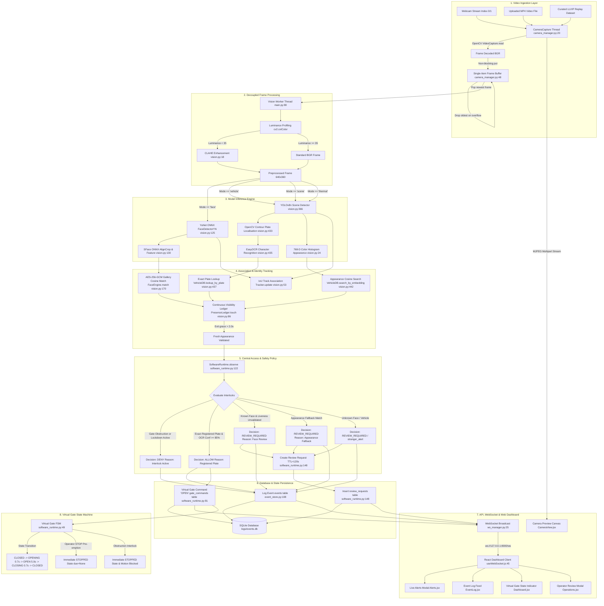

# INTELLIGATE: REPOSITORY ARCHITECTURE & PIPELINE TRACE AUDIT

**Document ID:** AUD-2026-10-02  
**Target Repository:** `D:\MZHR_FYP\INTELLIGATE`  
**Git Baseline:** Commit `ad76140`  
**Audit Date:** October 18, 2026  
**Auditing Standards:** Architecture Tradeoff Analysis Method (ATAM) & ISO/IEC 42010 Architecture Description  

---

## 1. Repository Inventory & Codebase Classification

The IntelliGate repository contains a dual codebase structure: a **legacy research implementation** (`module1_face_recognition`, `module2_vehicle`) created during early exploration, and an **integrated software prototype** (`module8_dashboard/backend`, `module8_dashboard/frontend`) representing the active running system.

### 1.1 Complete Codebase Classification

| Category | File / Path | Component Description | Operational Role | Rationale & Evidence |
|---|---|---|---|---|
| **Active Production** | `module8_dashboard/backend/main.py` | FastAPI server, API routing, WebSocket manager | **Primary Entrypoint** | Implements all 45 HTTP/WS routes; bootstraps software runtime, camera manager, and vision pipeline. |
| **Active Production** | `module8_dashboard/backend/vision.py` | Vision worker, YuNet, SFace, YOLOv8n, EasyOCR, tracking | **Inference Core** | Runs on background worker thread; executes real ONNX/YOLO inference on live/replay frames. |
| **Active Production** | `module8_dashboard/backend/software_runtime.py` | Access control policy, virtual gate FSM, safety interlocks | **Security Core** | Evaluates perception events; controls gate FSM states; manages 120s operator reviews. |
| **Active Production** | `module8_dashboard/backend/camera_manager.py` | Threaded video capture, MJPEG streaming, buffer | **Video Ingestion** | Reads webcam index or video files; drops stale frames into single-item buffer for inference worker. |
| **Active Production** | `module8_dashboard/backend/event_store.py` | SQLite store, session manager, AES-256-GCM cipher | **Persistence Core** | Manages SQLite schema (`events`, `alerts`, `cpu_faces`, `cpu_strangers`, `gate_commands`). |
| **Active Production** | `module8_dashboard/backend/auth.py` | Role-based authorization & cookie validation | **Security Layer** | Enforces `require_role('admin')`, `require_role('security_staff')`, and session validation. |
| **Active Production** | `module8_dashboard/backend/test_workbench.py` | Isolated component checks and test suite runner | **Test Workbench** | Executes in-memory unit tests; generates honest component status reports in Test Center. |
| **Active Production** | `module8_dashboard/frontend/src/` | React 18 single-page application | **Operator Interface** | Renders 8 views: Dashboard, CameraView, FaceDB, VehicleDB, EventLog, Alerts, Operations, TestCenter. |
| **Active Tooling** | `tools/run_project_checks.py` | CLI component smoke check utility | Verification Tool | Runs `component_checks()` and emits `logs/testing/component_checks_latest.json`. |
| **Active Tooling** | `tools/benchmark_cpu.py` | CPU latency profiler | Benchmarking Tool | Profiles YuNet, YOLOv8n, and CLAHE; outputs `logs/benchmarks/cpu_baseline.json`. |
| **Active Tooling** | `tools/benchmark_llvip.py` | LLVIP dataset evaluation script | Benchmarking Tool | Measures YOLO detection counts on visible, enhanced, and infrared pairs. |
| **Active Tooling** | `tools/download_face_models.py` | Model weight verification & downloader | Setup Utility | Validates SHA-256 hashes of YuNet and SFace ONNX models. |
| **Active Tooling** | `tools/prepare_demo_data.py` | Video clip splitter & asset preparer | Setup Utility | Prepares `face_smoke.mp4`, `llvip_visible.mp4`, `llvip_infrared.mp4`. |
| **Legacy Experimental** | `module1_face_recognition/face_recognizer.py` | ViT-Base/16 face embedding extractor (timm) | Disconnected | Generic ImageNet-21k ViT CLS token embedder. Untrained for face metric distance; disconnected from dashboard. |
| **Legacy Experimental** | `module1_face_recognition/face_detector.py` | MTCNN face detector (`facenet-pytorch`) | Disconnected | PyTorch MTCNN detector. High latency on CPU; replaced in active runtime by OpenCV YuNet ONNX. |
| **Legacy Experimental** | `module1_face_recognition/liveness_detector.py` | 4-stage anti-spoofing fusion coordinator | Disconnected | Fuses blink, texture, depth, mask. Not called by `vision.py` due to CPU budget and untrained heads. |
| **Legacy Experimental** | `module1_face_recognition/anti_spoofing/` | Blink, Depth, Texture, Mask heuristic classes | Disconnected | Standalone modules. Depth uses canonical 3D mesh (fails on photos); TextureCNN lacks weights. |
| **Legacy Experimental** | `module1_face_recognition/database/face_db.py` | HDF5 + FAISS face embedding database | Disconnected | Legacy plaintext biometric storage; superseded in active runtime by encrypted SQLite `cpu_faces`. |
| **Legacy Experimental** | `module2_vehicle/vehicle_detector.py` | YOLOv8 vehicle detector wrapper | Disconnected | Standalone wrapper; active runtime uses YOLOv8 directly inside `vision.py`. |
| **Legacy Experimental** | `module2_vehicle/plate_detector.py` | License plate localizer | Partially Reused | Active runtime instantiates `PlateDetector(allow_download=False)`, forcing OpenCV contour fallback. |
| **Legacy Experimental** | `module2_vehicle/plate_ocr.py` | EasyOCR license plate reader wrapper | Partially Reused | Active runtime instantiates `PlateOCR(gpu=False)` for license plate character recognition. |
| **Legacy Experimental** | `module2_vehicle/vehicle_reid.py` | ViT-Base/16 vehicle Re-ID extractor (timm) | Disconnected | Generic ImageNet ViT; active runtime uses 768-D color histogram baseline in `vision.py`. |
| **Legacy Experimental** | `module2_vehicle/database/vehicle_db.py` | SQLite + HDF5 vehicle registration database | Partially Reused | Active runtime uses `VehicleDatabase` for plate lookups and histogram candidate searches. |
| **Dead / Tracked Bloat** | `module1_face_recognition/**/__pycache__/*.pyc` | Compiled Python bytecode files | **Dead / Risk** | Tracked in Git history across commits `98df922` and `c909145`. Violates repo hygiene. |
| **Dead / Tracked Bloat** | `module2_vehicle/**/__pycache__/*.pyc` | Compiled Python bytecode files | **Dead / Risk** | Tracked in Git history across commits `98df922` and `c909145`. Violates repo hygiene. |
| **Dead / Sensitive Data** | `module1_face_recognition/database/face_embeddings.h5`| Unencrypted legacy biometric HDF5 file | **Security Defect** | Committed to Git in `98df922`. Contains legacy biometric embeddings; must be purged. |
| **Configured Unavailable**| `keremberke/yolov8n-license-plate` | PyTorch plate detection checkpoint (`.pt`) | Unavailable | Configured in `plate_detector.py:35–38`; download URL returns 404; forced to contour fallback. |
| **Placeholder / Mock** | `module8_dashboard/backend/software_runtime.py:206` | Incident summary generator (`report()`) | Active Runtime | String template concatenating SQL count queries; labeled `'event-template (not a VLM)'`. |
| **Placeholder / Mock** | `module8_dashboard/backend/software_runtime.py:220` | Natural language event search (`search()`) | Active Runtime | Simple keyword parser splitting words; labeled `'limited keyword parser'`. |
| **Placeholder / Mock** | `module8_dashboard/backend/vision.py:26` | Vehicle appearance feature extractor (`appearance()`) | Active Runtime | 768-D RGB color histogram; labeled `'colour histogram baseline, not a trained vehicle Re-ID'`. |

---

## 2. End-to-End Operational Pipeline Architecture

The active runtime implements an asynchronous, thread-decoupled decision support pipeline:



---

## 3. Transition Breakdown: File, Function & Line References

Every stage of the operational execution flow is traced directly to its implementation source lines:

```
[INGESTION]
  Source: Webcam index or MP4 file
  Component: CameraManager._capture_loop()
  File: module8_dashboard/backend/camera_manager.py, lines 20–75
  Mechanism: cv2.VideoCapture(source); decodes into memory; writes to self._pending_frame under lock.

[PREPROCESSING]
  Component: VisionWorker._run() -> ReplayPipeline.process_frame()
  File: module8_dashboard/backend/vision.py, lines 331–348
  Mechanism: Grabs latest pending frame; calculates frame luminance (line 351); applies CLAHE enhance() if dark (lines 18–21).

[MODEL INFERENCE]
  Component: FaceEngine.detect() & feature() / ReplayPipeline._process()
  File: module8_dashboard/backend/vision.py, lines 125–134 (Face), lines 366–367 (YOLOv8n)
  Mechanism: YuNet FaceDetectorYN ONNX forward pass; SFace FaceRecognizerSF ONNX forward pass; YOLOv8n CPU forward pass.

[POSTPROCESSING & TRACKING]
  Component: Tracker.update() & PresenceLedger.touch()
  File: module8_dashboard/backend/vision.py, lines 53–77 (Tracker), lines 86–94 (PresenceLedger)
  Mechanism: Global IoU association (threshold 0.25); identity appearance tracking with 2.0-second departure grace window.

[EVENT GENERATION]
  Component: ReplayPipeline.send()
  File: module8_dashboard/backend/vision.py, lines 227–240
  Mechanism: Constructs event dictionary with module, event_type, confidence, track_id, session_id, and meta payload.

[ACCESS CONTROL POLICY]
  Component: SoftwareRuntime.observe()
  File: module8_dashboard/backend/software_runtime.py, lines 122–155
  Mechanism: Evaluates safety interlocks, liveness validation flags, and OCR confidence. Outputs ALLOW, DENY, or REVIEW_REQUIRED.

[DATABASE PERSISTENCE]
  Component: EventStore.log_event() & SoftwareRuntime.save()
  File: module8_dashboard/backend/event_store.py, lines 108–135; software_runtime.py, lines 37–40
  Mechanism: SQLite parameterized INSERT into events, alerts, runtime_state, and gate_commands tables.

[API & WEBSOCKET DISTRIBUTION]
  Component: ConnectionManager.broadcast()
  File: module8_dashboard/backend/ws_manager.py, lines 25–48; main.py, lines 638–675
  Mechanism: Serializes event to JSON; pushes to all connected authenticated browser WebSocket clients.

[DASHBOARD PRESENTATION]
  Component: React 18 Components (App.jsx, Dashboard.jsx, Operations.jsx)
  File: module8_dashboard/frontend/src/components/Dashboard.jsx, lines 40–180
  Mechanism: React state updates; renders live bounding box overlays, activity feeds, metrics cards, and review modals.

[VIRTUAL GATE EXECUTION]
  Component: SoftwareRuntime.command() & tick()
  File: module8_dashboard/backend/software_runtime.py, lines 49–85, 104–120
  Mechanism: Advances deterministic finite state machine (`CLOSED` -> `OPENING` -> `OPEN` -> `CLOSING` -> `CLOSED`).
```

---

## 4. Complete Execution Trace of Five Core Scenarios

### Scenario 1: Registered Face Recognition Event
1. **Input:** Webcam frame containing enrolled user "Hussain".
2. **Preprocessing:** Frame resized to 640×360 (`vision.py:350`).
3. **Inference:** YuNet detects face bounding box `[180, 95, 220, 220]` with confidence 0.94 (`vision.py:126`). SFace extracts 128-D L2-normalized embedding vector (`vision.py:132`).
4. **Postprocessing:** `FaceEngine.match()` decrypts registered embeddings from SQLite table `cpu_faces` using AES-256-GCM (`vision.py:173`). Computes dot product; returns `(0.88, "Hussain")`. Threshold is 0.45.
5. **Tracking:** `PresenceLedger.touch(('face', 'Hussain'), now)` returns `fresh = True` (`vision.py:88`).
6. **Event Generation:** `ReplayPipeline.send()` emits `event_type = 'access_granted'`, `identity = 'Hussain'`, with meta `{'validated_liveness': False, 'liveness_status': 'unvalidated: manual approval required'}` (`vision.py:320`).
7. **Access Policy:** `SoftwareRuntime.observe()` checks `meta['validated_liveness']`. Because it is `False`, policy assigns `decision = 'REVIEW_REQUIRED'`, `reason = 'Identity or liveness requires operator review'` (`software_runtime.py:128`).
8. **Database:** Logs event as `recognition_candidate` in SQLite `events` (`software_runtime.py:139`). Inserts pending review record into `review_requests` table with 120s TTL (`software_runtime.py:148`).
9. **WebSocket:** Broadcasts `REVIEW_REQUIRED` event to frontend dashboard (`main.py:650`).
10. **Virtual Gate:** Gate remains `CLOSED`. Opening blocked pending human approval.

### Scenario 2: Authorized Vehicle Event
1. **Input:** Video frame containing registered vehicle with plate "LEA1234".
2. **Preprocessing:** RGB frame passed to YOLOv8 scene model (`vision.py:366`).
3. **Inference:** YOLOv8n detects car at `[120, 150, 480, 320]` (`conf=0.88`). Plate detector crops plate region. EasyOCR outputs `clean_text = 'LEA1234'`, `confidence = 0.91` (`vision.py:435–436`).
4. **Postprocessing:** `VehicleDatabase.lookup_by_plate('LEA1234')` returns registered record for owner "Mazhar" (`vision.py:437`).
5. **Event Generation:** `ReplayPipeline.send()` emits `event_type = 'access_granted'`, `identity = 'LEA1234'`, `method = 'exact_plate'`, `ocr_confidence = 0.91` (`vision.py:419`).
6. **Access Policy:** `SoftwareRuntime.observe()` evaluates rule: `module == 'vehicle' and method == 'exact_plate' and ocr_confidence >= 0.85` (`software_runtime.py:132`). Assigns `decision = 'ALLOW'`.
7. **Database:** Logs event as `access_granted` in SQLite `events` (`software_runtime.py:140`).
8. **Virtual Gate:** Executes `SoftwareRuntime.command('OPEN', 'access-policy')` (`software_runtime.py:143`). FSM transitions gate state to `OPENING` with `due = now + 0.7s` (`software_runtime.py:64`).
9. **WebSocket:** Pushes `OPENING` state and event to frontend dashboard.

### Scenario 3: Unknown Visitor / Stranger Memory Escalation
1. **Input:** Webcam frame containing unregistered individual.
2. **Inference:** YuNet detects face; SFace generates 128-D embedding.
3. **Matching:** `FaceEngine.match()` finds maximum cosine similarity 0.31 (< 0.45 threshold); identifies subject as unknown (`vision.py:305`).
4. **Stranger Clustering:** `FaceEngine.stranger(embedding)` searches SQLite table `cpu_strangers`. No match >= 0.45; generates new stranger UUID `stranger-4a8b...` and inserts encrypted embedding with current timestamp (`vision.py:183–185`).
5. **Event Generation:** Emits `stranger_alert` event (`vision.py:320`).
6. **Visitor Tracking:** `SoftwareRuntime.visit(stranger_id, ...)` records visit in `visitor_visits` table (`software_runtime.py:181`). Queries visit count over rolling 24-hour window (`seen >= now - 86400`).
7. **Escalation Trigger:** On the 3rd distinct appearance within 24 hours, count reaches 3. Condition `count >= 3 and (seen - last_alert >= 86400)` evaluates to `True` (`software_runtime.py:187`).
8. **Alert Generation:** Emits `repeat_visitor` event; logs `HIGH` severity alert in SQLite `alerts` table (`software_runtime.py:189`).
9. **WebSocket:** Dashboard alerts modal pops up alerting security operator to repeated loitering.

### Scenario 4: Gate Obstruction Safety Interlock Event
1. **Input:** Object or pedestrian enters the virtual gate safety corridor (`gate_roi=[0.4, 0.65, 0.6, 1.0]`) during gate closing.
2. **Inference:** YOLOv8n detects person at coordinates intersecting the gate ROI polygon (`vision.py:380`).
3. **Obstruction Evaluation:** `any(iou(track['box'], gate_roi_coords) > 0)` evaluates to `True`.
4. **Safety Enforcement:** Calls `SoftwareRuntime.obstruction(True, source='replay-0')` (`vision.py:383`).
5. **FSM Interlock:** `SoftwareRuntime.obstruction()` mutates gate state:
   - Sets `gate['obstruction'] = True`
   - Immediately changes `gate['state'] = 'STOPPED'`
   - Cancels pending motion tick (`due = None`)
   - Emits `safety / obstruction` event and logs `CRITICAL` alert (`software_runtime.py:95–101`).
6. **Command Pre-emption:** If operator simultaneously attempts to issue an `OPEN` or `CLOSE` command, `SoftwareRuntime.command()` raises `ValueError('Motion blocked by obstruction or lockdown')` (`software_runtime.py:61–62`).
7. **WebSocket:** Broadcasts red hazard banner to dashboard UI.

### Scenario 5: Operator Review Approval Command
1. **Input:** Authenticated security staff clicks "Approve" on pending face review in the dashboard (`Operations.jsx`).
2. **API Endpoint:** Frontend sends HTTP POST to `/api/reviews/{request_id}` with payload `{"approve": true}` (`main.py:466`).
3. **Authorization:** Middleware and `require_role('security_staff')` validate caller session and role permissions (`main.py:467`).
4. **Review Processing:** `SoftwareRuntime.review(request_id, approve=True, actor=user['username'])`:
   - Checks review record in SQLite: validates `status == 'PENDING'` and `expires > clock()` (`software_runtime.py:166`).
   - Updates review status to `APPROVED` with actor name (`software_runtime.py:172`).
   - Issues idempotent gate command: `command('OPEN', actor, command_id='review-{request_id}')` (`software_runtime.py:169`).
5. **Gate Execution:** Virtual gate transitions to `OPENING` state.
6. **Audit Event:** Emits audit event `access / approved` recording operator identity, request ID, and timestamp (`software_runtime.py:173`).
7. **WebSocket:** Closes review modal across all operator browser sessions and updates event timeline.

---

## 5. Architectural Bottlenecks & Integrity Gaps

1. **Global Inference Lock Bottleneck (`INFERENCE_LOCK`):**
   - **Location:** `module8_dashboard/backend/vision.py:15, 333`
   - **Mechanism:** A single re-entrant lock (`threading.RLock`) wraps the entire `process_frame()` method.
   - **Impact:** While thread-safe, this serializes all inference operations. If multiple cameras or concurrent test runs execute, they block on each other. When moving to multi-stream GPU execution, this lock must be replaced by per-worker queues.
2. **Unpinned Third-Party Plate Checkpoint URL:**
   - **Location:** `module2_vehicle/plate_detector.py:35–38`
   - **Mechanism:** Hardcodes a GitHub release URL (`keremberke/awesome-yolov8-models`) that returned HTTP 404, breaking automatic model acquisition.
   - **Remediation:** Bundle verified model weights locally in `models/` with SHA-256 verification.
3. **SQLite Concurrency Contention:**
   - **Location:** `module8_dashboard/backend/event_store.py:100–104`
   - **Mechanism:** SQLite connection is created per function call with `timeout=30.0` and `check_same_thread=False`.
   - **Risk:** High-frequency event emission during multi-camera replay can cause SQLite database locked errors. WAL (Write-Ahead Logging) pragma must be explicitly initialized on database bootstrap.
4. **In-Memory IP Rate Limiter Without Expiration Cleanup:**
   - **Location:** `module8_dashboard/backend/main.py:48–56`
   - **Mechanism:** Stores failed attempts in `FAILED_LOGINS: dict[str, list[float]]`.
   - **Defect:** IP keys are never deleted, creating a slow memory leak under distributed brute-force traffic. A bounded LRU cache or Redis/Valkey rate limiter is required.
