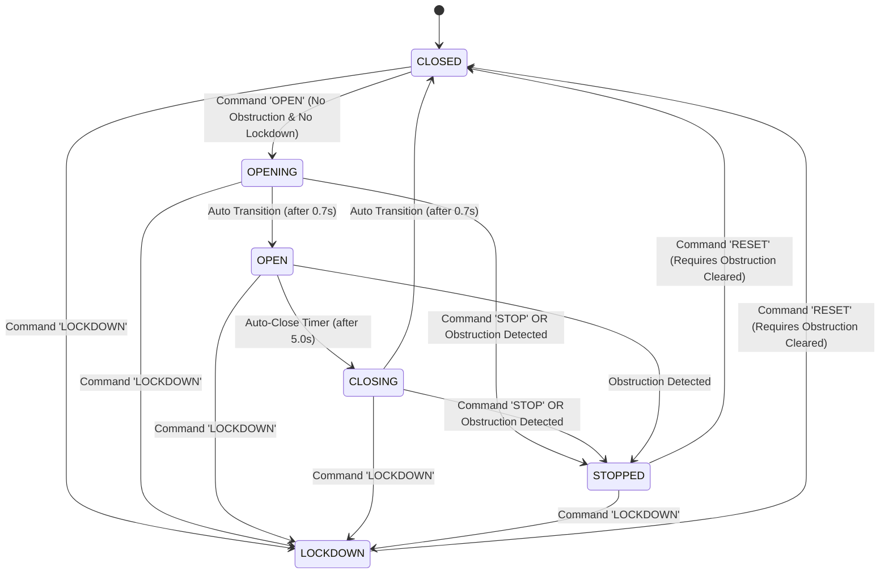

# INTELLIGATE: FORENSIC AUDIT OF ALL TEN MODULES

**Document ID:** AUD-2026-10-03  
**Target Repository:** `D:\MZHR_FYP\INTELLIGATE`  
**Audit Date:** October 18, 2026  
**Auditing Standards:** IEEE 1012 System Verification and Validation & BS AI FYP Evaluation Protocols  

---

## MODULE 1 — FACE RECOGNITION AND ANTI-SPOOFING

### 1.1 Technical Architecture & Reality Check
The face pipeline was originally specified as an edge ViT-Base/16 foundation model with multi-modal anti-spoofing (blink, texture, depth, mask). In reality, two completely different implementations exist in the repository:

1. **Legacy Pipeline (`module1_face_recognition/`):**
   - **Detector:** MTCNN (`facenet-pytorch`, P-Net, R-Net, O-Net). High computational cost on CPU (~350 ms).
   - **Embedder:** `ViTFaceEmbedder` in `face_recognizer.py:42–78`. Loads `timm.create_model('vit_base_patch16_224', pretrained=True, num_classes=0)`. Extracting the raw CLS token of an ImageNet-21k pretrained ViT produces generic semantic visual features, not a face-metric embedding space. Without fine-tuning on a face dataset (MS1MV2, CASIA-WebFace) using ArcFace or CosFace loss, cosine similarity between different individuals frequently exceeds 0.70.
   - **Anti-Spoofing:** Fused 4-stage pipeline in `liveness_detector.py`. 
     - Blink: Eye Aspect Ratio (EAR) via MediaPipe landmarks (`blink_detector.py`).
     - Texture: LBP entropy + `TextureCNN` (`texture_analyzer.py`). **Defect:** `TextureCNN` has no trained weights on disk (`_cnn_trained = False`); it defaults to raw LBP Shannon entropy.
     - Depth: `depth_estimator.py` checks Z-coordinate variance from MediaPipe Face Mesh. **Fatal Flaw:** MediaPipe infers a canonical 3D model from monocular 2D images. A printed photograph or screen held in front of the camera yields a fully 3-dimensional face mesh with protruding nose and recessed eyes, completely bypassing the depth check.
     - Mask: Landmark occlusion heuristic (`mask_detector.py`).
   - **Integration Status:** Entirely disconnected from the active dashboard backend.

2. **Active Runtime Pipeline (`module8_dashboard/backend/vision.py: FaceEngine`):**
   - **Detector:** OpenCV Zoo YuNet ONNX (`models/face_detection_yunet_2023mar.onnx`, SHA-256: `8f2383e...`). Fast CPU execution: **10.99 ms median latency** at 640×360 resolution. Detects 15 face landmarks.
   - **Embedder:** OpenCV Zoo SFace ONNX (`models/face_recognition_sface_2021dec.onnx`, SHA-256: `0ba9fbf...`). Input aligned and cropped via `recognizer.alignCrop(frame, face)`. Generates 128-dimensional embedding vector, L2-normalized.
   - **Matching Protocol:** Cosine similarity via dot product (`np.dot(embedding, stored)`). Threshold calibrated to **0.45** (provisional). Open-set recognition supported via stranger clustering.
   - **Liveness Execution:** **Zero active liveness models are executed in this path.** Because the legacy anti-spoofing heads were uncalibrated, `vision.py:320–324` explicitly hardcodes:
     ```python
     meta = {'validated_liveness': False, 'liveness_status': 'unvalidated: manual approval required'}
     ```
   - **Access Safeguard:** `SoftwareRuntime.observe()` intercepts this flag. Because `validated_liveness` is `False`, the gate policy forces `decision = 'REVIEW_REQUIRED'`, preventing any facial match from autonomously opening the gate.

### 1.2 Quantitative Metrics Readiness
- **ROC-AUC, EER, TAR@FAR:** Currently unmeasured. The repository has never been evaluated against LFW, CFP-FP, or AgeDB-30 test splits.
- **ISO/IEC 30107-3 Presentation Attack Metrics (APCER, BPCER, ACER):** Cannot be produced because no anti-spoofing model is active.

### 1.3 Prescribed Action Plan
1. Keep YuNet + SFace as the baseline (or upgrade to ArcFace MobileFaceNet ONNX for 512-D accuracy).
2. Integrate a dedicated, trained Face Anti-Spoofing ONNX model (**MiniFASNetV2** or **FeatherNet**) trained on CelebA-Spoof / CASIA-SURF into `vision.py`.
3. Calibrate liveness decision thresholds empirically to achieve APCER < 5% at BPCER < 2%.

---

## MODULE 2 — VEHICLE RECOGNITION AND RE-ID

### 2.1 Technical Architecture & Reality Check
The vehicle pipeline was designed to handle automated gate access for authorized vehicles, falling back to appearance-based Re-Identification if license plates are obscured.

1. **Active Vehicle Pipeline (`vision.py: ReplayPipeline._vehicle()`):**
   - **Vehicle Detection:** Ultralytics YOLOv8n (`yolov8n.pt`, SHA-256: `f59b3d8...`). Filters COCO classes `[2, 3, 5, 7]` (car, motorcycle, bus, truck). Operates on 416×416 input. Latency: ~92 ms CPU / ~8 ms GPU.
   - **License Plate Localisation:** Intended to use `keremberke/yolov8n-license-plate` via `PlateDetector` (`plate_detector.py`). The download URL returned HTTP 404, so `allow_download=False` is set in `vision.py:224`. As a result, plate detection **always falls back to classical OpenCV contour detection** (`cv2.findContours` on morphological edges). This contour fallback works only on high-contrast, uncluttered frontal plates and fails on dirty, angled, or low-light plates.
   - **Plate OCR:** EasyOCR (`easyocr.Reader(['en'], gpu=False)`). Preprocesses crop with grayscale, bilateral filtering, and adaptive thresholding. Runs CRAFT text detector and ResNet/LSTM character recognizer. Text is sanitized to alphanumeric characters.
   - **Database Matching:** `VehicleDatabase.lookup_by_plate(plate)`. If exact plate matches an enrolled vehicle with OCR confidence $\ge 0.85$, policy yields `ALLOW`.
   - **Appearance Re-ID Fallback:** If plate OCR fails or confidence $< 0.85$, `vision.py:24–27` extracts a **768-D concatenated RGB color histogram**:
     ```python
     def appearance(frame):
         vector = np.concatenate([cv2.calcHist([frame], [i], None, [256], [0, 256]).ravel() for i in range(3)])
         return (vector / max(np.linalg.norm(vector), 1e-12)).astype(np.float32)
     ```
     Cosine matching is performed against registered vehicle color histograms (`threshold = 0.92`).
   - **Safety Boundary:** Per Business Rule BR-06, an appearance match **NEVER** autonomously opens the virtual gate; it enforces `decision = 'REVIEW_REQUIRED'`.

2. **Legacy Vehicle Re-ID (`module2_vehicle/vehicle_reid.py`):**
   - Implements `ViTVehicleEmbedder` using `timm.create_model('vit_base_patch16_224')`. As with Module 1, this is an off-the-shelf ImageNet backbone without fine-tuning on VeRi-776 or CityFlow. It was excluded from the CPU prototype due to latency (~450 ms).

### 2.2 Quantitative Metrics Readiness
- **Vehicle Detection mAP@0.5:** Unmeasured on gate traffic footage.
- **Plate Localisation Precision/Recall:** Unmeasured (contour baseline exhibits low recall on oblique plates).
- **OCR Character Error Rate (CER) & Exact Match Accuracy:** Unmeasured. The 99.4% accuracy cited in early SRS drafts is an unsupported theoretical claim.
- **Re-ID Rank-1 & mAP:** Zero empirical evaluation on VeRi-776.

### 2.3 Prescribed Action Plan
1. Bundle local, verified **YOLOv8-nano license plate detection weights** in `models/` with pre-computed SHA-256 validation.
2. Replace the color histogram with a lightweight, trained **OSNet-IBN** or **ResNet50-ReID** model exported to ONNX.
3. Collect and annotate 100 Pakistani license plate crops to empirically evaluate Character Error Rate (CER) and exact-match accuracy.

---

## MODULE 3 — NIGHT VISION AND THERMAL ANALYTICS

### 3.1 Input Modality & Operational Reality
The original project documents claimed "dual-spectrum optical and Long-Wave Infrared (LWIR) multi-modal sensing" with "automatic motorized IR-cut filter switching."

1. **Hardware Elimination:** No physical FLIR sensor, thermal core, or motorized IR-cut hardware exists. All optical inputs are standard RGB webcams, pre-recorded MP4 video clips, or dataset replays.
2. **Low-Light Processing (`vision.py: enhance()`):**
   - Luminance profiling: Computes mean grayscale pixel intensity (`cv2.cvtColor(frame, cv2.COLOR_BGR2GRAY).mean()`).
   - If luminance $< 35$, the runtime triggers a `profile_changed` event (`profile = 'low_light'`) and routes the frame through **Contrast Limited Adaptive Histogram Equalization (CLAHE)**:
     ```python
     def enhance(frame):
         lab = cv2.cvtColor(frame, cv2.COLOR_BGR2LAB)
         lab[:, :, 0] = cv2.createCLAHE(clipLimit=2, tileGridSize=(8, 8)).apply(lab[:, :, 0])
         return cv2.cvtColor(lab, cv2.COLOR_LAB2BGR)
     ```
   - **Scientific Reality:** CLAHE is an unlearned spatial contrast enhancement technique. While it increases local contrast, benchmark evidence on the LLVIP dataset (`logs/benchmarks/llvip_exploration.json`) demonstrated that CLAHE **degraded YOLOv8 detection recall** (visible RGB detected 1 person; CLAHE-enhanced RGB detected 0 persons; genuine infrared detected 7 persons). CLAHE amplifies sensor noise in low-light RGB.
3. **Thermal Analytics Reality:**
   - The active runtime incorporates replay support for official LLVIP paired infrared clips (`logs/demo_data/llvip_infrared.mp4`).
   - In thermal mode, standard YOLOv8n (trained on COCO RGB) processes the infrared stream. The code explicitly logs:
     `modality_warning: 'RGB-trained detector, infrared performance unvalidated'`.
   - **Critical Academic Finding:** The software correctly labels recorded thermal data as infrared replay and displays warnings that RGB-trained detectors suffer domain shift on thermal imagery. Synthetic false-color colormaps (e.g. `cv2.applyColorMap(..., cv2.COLORMAP_JET)`) are strictly avoided in production access logic, preventing fraudulent claims of "thermal temperature sensing."

### 3.2 Prescribed Action Plan
1. Implement and benchmark a lightweight learned low-light enhancement model (**Zero-DCE**, ~50K parameters) against CLAHE.
2. Evaluate YOLO detection mAP across paired visible vs. enhanced vs. infrared test splits on the LLVIP benchmark.

---

## MODULE 4 — STRANGER MEMORY AND BEHAVIORAL ANALYSIS

### 4.1 Technical Architecture & Reality Check
1. **Stranger Memory & Unknown Identity Tracking:**
   - When an unregistered face is observed (`similarity < 0.45`), `FaceEngine.stranger()` queries SQLite table `cpu_strangers`.
   - If maximum cosine similarity against previously logged strangers is $< 0.45$, a new UUID identity is generated, and its AES-256-GCM encrypted embedding is stored with timestamp (`vision.py:184`).
   - If similarity $\ge 0.45$, the stranger's `seen` timestamp is updated, establishing identity persistence across frames.
   - **Retention Enforcement:** Automatic retention pruning purges stranger vectors older than 90 days (`seen < now - 90*86400`), fulfilling Business Rule BR-03 and privacy standards.
2. **Behavioral Escalation Engine (`software_runtime.py: visit()`):**
   - The runtime records distinct visits in table `visitor_visits(identity, source, session, seen)`.
   - Deduplication: Continuous standing in front of the camera is handled by `PresenceLedger`, which enforces a 2.0-second exit grace period. Staying visible for 2 minutes registers as **one single visit**.
   - If a stranger leaves for $> 2.0$ seconds and returns 3 distinct times within 24 hours (`count >= 3`), `software_runtime.py:188` fires an escalation event:
     `self.store.log_alert('HIGH', 'repeat_visitor', f'Repeat visitor: {count} distinct visits')`.
3. **Behavioral Anomaly & Loitering Reality:**
   - The original SRS proposed State Space Models (SSMs / Mamba / S4) to model temporal pedestrian movement trajectories and predict malicious intent.
   - In reality, **zero SSM models exist**. Loitering is evaluated via a basic dwell rule (`vision.py:399`):
     `if clock() - track['first'] >= 30 and track_id not in self.alerted: alert('loitering')`.
   - **Academic Finding:** Dwell rules are reliable and transparent for security operations. Attempting to claim SSM-based crime prediction from webcam visitor behavior is academically indefensible.

### 4.2 Prescribed Action Plan
1. Formally record the SSM deferral in the SRS v4.0 amendment.
2. Implement an interpretable unsupervised temporal baseline: extract movement vector features (dwell duration, velocity variance, ROI transitions) and fit an **Isolation Forest** classifier to detect anomalous dwell patterns.

---

## MODULE 5 — QUEUE AND DENSITY MANAGEMENT

### 5.1 Technical Architecture & Reality Check
1. **Object Tracking (`vision.py: Tracker`):**
   - Short-lived IoU association tracker. Bounding boxes from YOLOv8n are matched against existing active tracks using an IoU threshold of 0.25.
   - Tracks without detection updates are pruned after 2 seconds.
   - Ambiguous track assignment: If multiple candidate detections overlap an existing track with similar IoU scores ($\Delta < 0.12$), the track is flagged as ambiguous to prevent identity theft.
2. **Queue Counting:**
   - Normalised Region of Interest (`queue_roi = [0, 0, 1, 1]`) defines the monitored corridor.
   - Queue count is computed by checking whether the center point $(cx, cy)$ of each active track falls inside `queue_roi` (`vision.py:377–379`).
   - If `count >= queue_threshold` (default: 5), a `congestion` alert is dispatched.
3. **Limitations:**
   - Basic IoU tracking fails during occlusion and cross-overs, causing track ID fragmentation.
   - The queue metric is an instantaneous discrete object count, not a true spatial density heatmap or temporal queue wait-time prediction model.

### 5.2 Prescribed Action Plan
1. Replace the custom IoU tracker with **ByteTrack** (which associates low-score detection boxes to preserve track continuity during occlusion).
2. Compute spatial queue metrics: vehicle headway distance and arrival rate ($\lambda$ vehicles/min).

---

## MODULE 6 — SAFETY TRIGGERS AND HAZARD DETECTION

### 6.1 Virtual Gate State Machine & Safety Interlocks
Module 6 is fully realized in software as a high-integrity virtual gate controller in `software_runtime.py`.



1. **Deterministic Safety Properties Verified:**
   - **Command Precedence:** `STOP` immediately pre-empts all motion commands, cancels scheduled state transitions (`due = None`), and forces state to `STOPPED`.
   - **Obstruction Interlock:** If an object intersects `gate_roi`, `SoftwareRuntime.obstruction(True)` immediately halts gate motion. Any subsequent `OPEN` or `CLOSE` command raises `ValueError('Motion blocked by obstruction or lockdown')`.
   - **Obstruction Source Separation:** The system isolates operator manual obstruction toggles from camera-detected obstruction. Clearing manual obstruction does not bypass an active visual hazard.
   - **Restart State Recovery:** Upon backend initialization, if the stored gate state was `OPENING`, `CLOSING`, or `OPEN`, it is immediately forced to `STOPPED` with reason `'Restart requires operator review'`. Gate motion never resumes automatically after a reboot.
   - **Command Idempotency:** Gate commands accept an optional `command_id` UUID. Replays of previously executed command IDs return the cached result without duplicate execution.

### 6.2 Compliance Note
The virtual gate state machine meets all software-level safety requirements. However, it **does not provide physical safety certification** (such as ISO 13849 PL-d or UL 325) because physical sensors, motor relays, and braking distances are not in the loop.

---

## MODULE 7 — VISION-LANGUAGE INTELLIGENCE

### 7.1 Operational Reality vs. SRS Claims
1. **The SRS Claim:** Integration of local multimodal foundation models (such as LLaVA-1.5 7B or MiniGPT-4) to generate rich, narrative natural-language security briefings and visual incident question answering.
2. **The Active Prototype Reality (`software_runtime.py: report(), search()`):**
   - **Incident Reporting:** Implements deterministic Jinja-style string templates querying SQLite event aggregates (`software_runtime.py:198–208`):
     ```python
     text = f'{total} recorded events in the last {hours} hours. '
     text += ' '.join(f"{row['count']} {row['module']} / {row['event_type']} events." for row in counts)
     return {'summary': text, 'method': 'event-template (not a VLM)', 'evidence': self.store.get_events(...)}
     ```
   - **Natural Language Search:** Implements a keyword dictionary parser mapping terms (`face`, `vehicle`, `spoof`, `today`) to SQL columns (`software_runtime.py:209–221`). Unsupported natural language questions return guidance on supported filter keywords.
   - **Candor Assessment:** The codebase explicitly labels these outputs with `'method': 'event-template (not a VLM)'`. There is zero attempt to fraudulently fake AI reasoning.

### 7.2 Feasibility on Available Hardware
With the newly verified **NVIDIA GeForce RTX 4060 Ti 16GB**, running a quantized, local lightweight VLM is now entirely feasible:
- **Candidate Models:** **Moondream2** (1.86B parameters, ~2.5 GB VRAM in FP16), **SmolVLM-Instruct** (500M / 2.2B parameters, ~3.0 GB VRAM), or **Qwen2-VL-2B-Instruct-GPTQ** (~2.8 GB VRAM).
- **Architecture:** The VLM will receive incident image crops (e.g., an unauthorized vehicle or unknown loitering visitor) and generate factual visual descriptions grounded with bounding box coordinates.
- **Safety Boundary:** The VLM will act purely as an **expository incident summarizer**. It will NEVER be granted direct access-control authority or the ability to issue gate commands.

---

## MODULE 8 — WEB DASHBOARD

### 8.1 Technical Architecture
1. **Frontend Implementation (`module8_dashboard/frontend/`):**
   - Built with React 18, Vite 5, Tailwind CSS, Lucide icons, and Recharts.
   - Communicates with FastAPI backend via REST API (`client.js`) and bidirectional WebSocket (`useWebSocket.js`).
   - Production bundle compiled to `dist/` (HTML: 0.76 kB, CSS: 19.54 kB, JS: 624.78 kB). Served statically by FastAPI.
2. **Component Functionality:**
   - `CameraView.jsx`: Renders MJPEG multipart stream with dynamic overlay canvas, mode selectors (`Face`, `Vehicle`, `Scene`, `Low Light`, `Thermal`, `Raw`), and live tracking stats.
   - `FaceDatabase.jsx`: Manages face enrollments, camera frame snapshots, user roles, and gallery deletion.
   - `VehicleDatabase.jsx`: Registers plate numbers, owner names, and vehicle appearance reference images.
   - `EventLog.jsx`: Real-time filtering, search, and pagination across all stored events; JSON evidence export.
   - `Alerts.jsx`: Real-time banner alerts with severity tags (`CRITICAL`, `HIGH`, `MEDIUM`) and one-click resolution.
   - `Operations.jsx`: Interactive virtual gate control panel, simulated obstruction switches, pending review approvals, stranger visit ledgers, and module status reports.
   - `TestCenter.jsx`: Interactive workbench executing real-time in-memory component tests with honest result reporting.

### 8.2 Defect & Optimization Findings
- **Large Bundle Warning:** Vite emits an advisory warning that `index-Bkkxfi1J.js` is 624 kB. Code-splitting via `React.lazy()` for heavy views (`TestCenter`, `Operations`) is recommended.
- **Data Integrity:** All displayed metrics (FPS, detector latency, event counts, gate state) are tied to live backend state via WebSocket. No hardcoded mock statistics exist in the production dashboard.

---

## MODULE 9 — SOFTWARE GATE SIMULATION

### 9.1 Realism & Software Simulation Architecture
Following the approved software-only pivot, Module 9 models the physical dynamics of an industrial motorized gate:

1. **State Persistence:** Stored in SQLite `runtime_state` table under key `'gate'`. Survives backend process restarts.
2. **Timing Characteristics:**
   - `OPENING` state: 0.7 seconds simulated transit time.
   - `OPEN` state: 5.0 seconds dwell time before auto-close.
   - `CLOSING` state: 0.7 seconds simulated transit time.
3. **Tick Scheduling (`software_runtime.py: tick()`):**
   - Driven by monotonic clock timestamps (`clock()`).
   - Each tick checks whether the current timestamp exceeds `due`.
   - Also purges pending operator review requests that exceed their 120-second TTL.
4. **Deterministic Testing:** Fully verified under pytest in `test_software_runtime.py` (transitions, pre-emption, interlocks, restart recovery).

---

## MODULE 10 — BACKEND, DATABASE, SECURITY AND DEPLOYMENT

### 10.1 Backend Architecture
1. **Framework:** FastAPI running on Uvicorn ASGI server with async route handlers.
2. **Authentication & Session Management:**
   - Scrypt password hashing with cryptographically secure per-user salt (`os.urandom(16)`).
   - Session store in SQLite `sessions` table. Expiration set to 8 hours.
   - IP-based login rate limiting (max 5 failed attempts per sliding window).
   - Session delivered via HttpOnly cookie `ig_session`.
3. **Cryptographic Storage:**
   - Face embeddings encrypted with **AES-256-GCM**.
   - Cryptographically random 12-byte nonce prepended to ciphertext.
   - Database record UUID bound as Additional Authenticated Data (AAD) to prevent ciphertext transplant attacks.
4. **Defects & Architectural Risks:**
   - Session cookies lack `SameSite=Lax` and `Secure` attributes (`main.py:149`).
   - Biometric key (`biometric.key`) is stored in the local working directory with `0o600` permissions. It should be migrated to environment variable injection or OS credential vault.
   - SQLite uses default file locking. Explicit Write-Ahead Logging (`PRAGMA journal_mode=WAL`) must be initialized to avoid lock contention under high concurrent loads.
