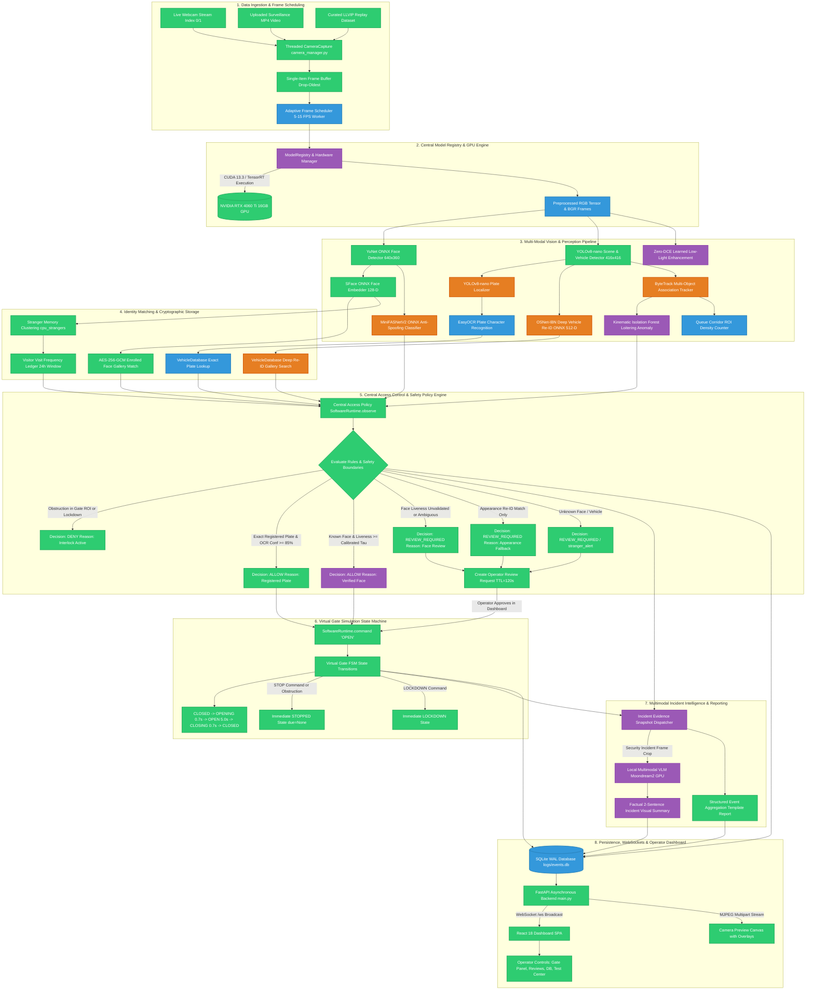

# INTELLIGATE: PROPOSED TARGET ARCHITECTURE & SPECIFICATION

**Document ID:** AUD-2026-10-11  
**Target Repository:** `D:\MZHR_FYP\INTELLIGATE`  
**Architecture Style:** Modular Monolith with Asynchronous Ingestion & GPU Offloaded Inference  
**Audit Date:** October 18, 2026  

---

## 1. Architectural Philosophy & Core Principles

The target architecture is governed by four non-negotiable engineering principles:

1. **Strict Decoupling of Perception from Authority:**
   Artificial Intelligence models are probabilistic estimators with non-zero error distributions. An AI observation (e.g. a face match or appearance similarity) is an *advisory signal*, never an authoritative command. All access decisions and gate actuations are enforced by a deterministic, auditable **Central Access & Safety Policy** running a fail-secure state machine.
2. **Asynchronous Frame Ingestion & Dropping:**
   Video capture must never block on heavy neural network inference. The video ingestion layer operates on a separate thread, decoding frames continuously and maintaining a single-item drop-oldest buffer. If the inference worker takes 80 ms, intermediate video frames are safely dropped, guaranteeing zero preview lag.
3. **Explicit Confidence & Uncertainty Escalation:**
   Every perception result carries an explicit confidence score and method tag. High confidence on validated signals (e.g. exact registered plate $\ge 0.85$) triggers automated entry. Low confidence or unvalidated modalities (e.g. face matches without deep liveness, vehicle appearance fallback) escalate to a human operator via a 120-second sliding review window.
4. **Pragmatic Monolith over Distributed Microservices:**
   IntelliGate avoids unnecessary microservices, message brokers (Kafka/RabbitMQ), and distributed object stores (SeaweedFS). A cohesive, modular Python FastAPI monolith with in-memory thread queues and SQLite WAL persistence provides maximum developer velocity, zero deployment friction, and optimal viva defensibility.

---

## 2. End-to-End System Architecture Diagram

The target architecture spans eight functional tiers, explicitly color-coded by implementation status:
- **[GREEN]** Already Implemented & Operational
- **[BLUE]** Reusable with Configuration / Minor Changes
- **[AMBER]** Needs Replacement / Heuristic Upgrade
- **[PURPLE]** New Implementation



---

## 3. Implementation Status Taxonomy of Architectural Components

| Component / Layer | Source File / Module | Implementation Status | Technical Action in Roadmap |
|---|---|---|---|
| **Camera Capture Thread** | `camera_manager.py` | **Already Implemented** | Keep as-is. Thread-safe non-blocking capture buffer works reliably. |
| **YuNet Face Detector** | `vision.py` | **Already Implemented** | Keep as-is. 10.99 ms CPU latency; enable CUDA provider for ~3.0 ms GPU. |
| **SFace Face Embedder** | `vision.py` | **Already Implemented** | Keep as-is. 128-D L2-normalized embedding; enable CUDA provider. |
| **AES-256-GCM Biometric Store**| `vision.py`, `event_store.py` | **Already Implemented** | Keep as-is. Record-bound AAD prevents ciphertext transplant attacks. |
| **Virtual Gate State Machine**| `software_runtime.py` | **Already Implemented** | Keep as-is. Deterministic FSM, emergency stop preemption, restart recovery. |
| **Visitor Escalation Ledger**| `software_runtime.py` | **Already Implemented** | Keep as-is. 3 visits in 24h triggers HIGH alert. |
| **React 18 Operator Dashboard**| `module8_dashboard/frontend` | **Already Implemented** | Keep as-is. Optimize bundle size via code-splitting. |
| **Central Access Policy** | `software_runtime.py` | **Reusable with Changes** | Wire new deep liveness threshold into `observe()` to enable autonomous face opening. |
| **EasyOCR Engine** | `vision.py` | **Reusable with Changes** | Enable GPU device (`gpu=True`) to drop OCR latency from 380 ms to ~45 ms. |
| **SQLite Event Database** | `event_store.py` | **Reusable with Changes** | Add explicit Write-Ahead Logging (`PRAGMA journal_mode=WAL`) on connection bootstrap. |
| **License Plate Localizer** | `plate_detector.py` | **Needs Replacement** | Replace OpenCV contour fallback with local verified YOLOv8-nano plate weights. |
| **Face Anti-Spoofing** | `anti_spoofing/` | **Needs Replacement** | Replace untrained heuristics with pretrained **MiniFASNetV2 ONNX** model. |
| **Vehicle Appearance Re-ID** | `vision.py: appearance()` | **Needs Replacement** | Replace 768-D color histogram with **OSNet-IBN ONNX** metric embeddings. |
| **Object Tracking** | `vision.py: Tracker` | **Needs Replacement** | Replace basic IoU tracker with **ByteTrack** for occlusion resilience. |
| **Model Registry & Hardware Mgr**| `models/` | **New Implementation** | Centralized class that checks CUDA availability and validates model SHA-256 hashes. |
| **Learned Low-Light Enhancer**| `vision.py` | **New Implementation** | Integrate **Zero-DCE ONNX** for learned dynamic range adjustment. |
| **Kinematic Anomaly Detector**| `software_runtime.py` | **New Implementation** | Implement **Isolation Forest** over 5-D trajectory kinematics for loitering detection. |
| **Local Multimodal VLM** | `vlm_engine.py` | **New Implementation** | Deploy **Moondream2 (1.86B)** on RTX 4060 Ti GPU for visual incident summaries. |

---

## 4. Communication Contracts & Event Schemas

All inter-module communication is mediated by structured JSON event envelopes:

```json
{
  "event_id": 1420,
  "timestamp": "2026-10-18T12:30:00.123456Z",
  "source_id": "camera-0",
  "module": "face",
  "event_type": "access_granted",
  "identity": "Hussain",
  "confidence": 0.8842,
  "method": "SFace-ONNX",
  "decision": "ALLOW",
  "reason": "Registered face with verified deep liveness",
  "evidence": {
    "track_id": 4,
    "session_id": "sess-9a8b7c6d:visit-104",
    "liveness_model": "MiniFASNetV2",
    "liveness_score": 0.9621,
    "liveness_status": "PASS",
    "bounding_box": [180.2, 95.0, 400.5, 315.0],
    "simulated": true
  }
}
```

---

## 5. Safety Boundaries & Security Safeguards

1. **VLM Expository Isolation:**
   The multimodal Vision-Language Model (Moondream2) has **zero connection** to gate control endpoints. It operates purely as an event consumer: it reads saved incident image crops and writes descriptive text to the incident log. It cannot open, close, or stop the gate under any circumstances.
2. **Fail-Secure Interlock Priority:**
   Safety interlocks strictly supersede all perception decisions:
   $$\text{Decision} = \begin{cases} 
   \text{DENY (Interlock)}, & \text{if } \text{Obstruction} \lor \text{Lockdown} \\
   \text{ALLOW}, & \text{if } (\text{ExactPlate} \land \text{Conf} \ge 0.85) \lor (\text{KnownFace} \land \text{Liveness} \ge \tau) \\
   \text{REVIEW\_REQUIRED}, & \text{otherwise}
   \end{cases}$$
3. **Idempotent Actuation:**
   Every operator review approval and automated access event generates a cryptographically random command UUID. Repeating the request returns the prior state without re-triggering mechanical simulation timers.
