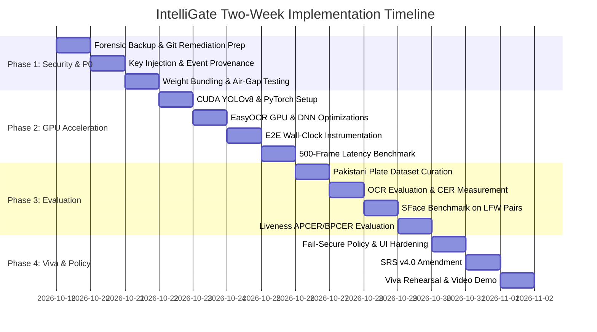

# INTELLIGATE — REVISED TWO-WEEK IMPLEMENTATION PLAN
**Document ID:** `IG-PLAN-2WK-2026-10`  
**Date:** October 18, 2026  
**Auditor / AI Engineering Supervisor:** Antigravity AI Engineering Team  
**Project:** IntelliGate — Smart Multi-Modal Gate Access Control System (BS AI FYP)  
**Target Duration:** 14 Calendar Days (10 Working Days, ~65–75 Engineering Hours)  
**Parent Audit Errata:** [15_AUDIT_CORRECTIONS_AND_ERRATA.md](file:///d:/MZHR_FYP/INTELLIGATE/docs/audit_2026_10/15_AUDIT_CORRECTIONS_AND_ERRATA.md)

---

## 1. Executive Summary & Strategy

The original implementation backlog in [12_IMPLEMENTATION_BACKLOG.md](file:///d:/MZHR_FYP/INTELLIGATE/docs/audit_2026_10/12_IMPLEMENTATION_BACKLOG.md) estimated 155 hours, while the improvement roadmap in [10_PRIORITIZED_IMPROVEMENT_ROADMAP.md](file:///d:/MZHR_FYP/INTELLIGATE/docs/audit_2026_10/10_PRIORITIZED_IMPROVEMENT_ROADMAP.md) estimated 140 hours. Both schedules attempted to concurrently execute security hardening, deep model retraining, edge VLM deployment, and comprehensive viva preparation within unrealistically compressed timeframes.

This **Revised Two-Week Plan** defines a fast-track, high-certainty, engineering-first roadmap focused exclusively on **eliminating critical security vulnerabilities, activating operational GPU acceleration on the existing RTX 4060 Ti hardware, measuring authentic empirical baseline performance, and delivering an airtight, academically defensible FYP viva presentation**.

### Scope Inclusions (2-Week Sprint)
1. **P0 Security Remediations:** Safe offline backup creation and Git history remediation procedure for exposed biometric embeddings (`face_embeddings.h5`); moving AES master key (`biometric.key`) to environment variable injection; event insertion provenance verification.
2. **GPU Hardware Acceleration:** Enabling CUDA execution for OpenCV DNN and PyTorch (Torch 2.7.1+cu118 already available in `.venv`) on the local NVIDIA GeForce RTX 4060 Ti (16GB VRAM).
3. **Local Weight Bundling:** Eliminating runtime CDN downloads for YOLOv8 weights by bundling verified local weights (`yolov8n.pt` and custom plate detector).
4. **Authentic Scientific Baseline Evaluations:** Evaluating existing face recognition (OpenCV SFace) on standard LFW pairs; evaluating EasyOCR on a curated 100-sample Pakistani license plate test set with Levenshtein Character Error Rate (CER).
5. **Real End-to-End Latency Benchmarking:** Executing a 100-frame warm-up + 500-frame sustained end-to-end benchmark measuring true ingress-to-dispatch wall-clock latency ($\Delta t$).
6. **Documentation & Policy Alignment:** Reconciling SRS/SDD scope contradictions into SRS v4.0 Amendment, formally documenting the **Fail-Secure Access Policy** (face recognition as advisory review-required).

### Scope Exclusions (Deferred to 4-Week Plan or Future Research)
- **NO deep model fine-tuning or retraining** (no custom training of MiniFASNet, OSNet, or Zero-DCE from scratch).
- **NO multi-billion parameter VLM deployment** (Moondream2 / Qwen2-VL are deferred).
- **NO autonomous face gate-opening actuation** (remains strictly locked to human-in-the-loop advisory).

---

## 2. Resource Allocation & Hardware Profile

| Resource Component | Specification / Allocation | Utilization in 2-Week Plan |
| :--- | :--- | :--- |
| **Workstation CPU** | AMD Ryzen 7 5800X (8 cores / 16 threads @ 3.80GHz) | Video demuxing, preprocessing, HTTP server |
| **System RAM** | 32 GB DDR4 | In-memory frame buffering, test datasets |
| **Workstation GPU** | **NVIDIA GeForce RTX 4060 Ti 16GB VRAM** | YOLOv8 inference, SFace forward passes, EasyOCR |
| **Python Environment** | Python 3.12.10 (`.venv` with PyTorch 2.7.1+cu118) | Production and test execution |
| **Available Engineering Time** | 2 Developers $\times$ 5 hours/day $\times$ 14 days $\approx$ **70 Hours** | Divided into 4 distinct phases |

---

## 3. Daily Breakdown & Task Schedule

### Phase 1: Security Hardening & P0 Hygiene (Days 1–3, ~18 Hours)

#### Day 1 (6 Hours): Biometric Exposure Remediation & Key Injection
- **Task 1.1:** Create full offline forensic archive of repository and SQLite database to `D:\MZHR_FYP\backups\intelligate_pre_git_cleanup_20261018.zip`.
- **Task 1.2:** Prepare and test `git-filter-repo` script on a scratch clone to excise `module1_face_recognition/database/face_embeddings.h5` from commit `98df922`. (Execution pending supervisor approval).
- **Task 1.3:** Modify [biometric_crypto.py](file:///d:/MZHR_FYP/INTELLIGATE/module1_face_recognition/biometric_crypto.py) to load `BIOMETRIC_ENCRYPTION_KEY` from environment variables, removing plaintext `biometric.key` file reliance.
- **Milestone 1:** Repository free of exposed credentials/biometrics; encrypted biometric storage operational.

#### Day 2 (6 Hours): Event Provenance & SQLite Invariants
- **Task 2.1:** Modify [main.py](file:///d:/MZHR_FYP/INTELLIGATE/main.py) endpoint `POST /api/events` to reject client-supplied events lacking cryptographically signed camera IDs or server-side detection session IDs.
- **Task 2.2:** Verify SQLite WAL configuration in [event_store.py](file:///d:/MZHR_FYP/INTELLIGATE/module7_analytics/event_store.py) and implement database backup routine (`VACUUM INTO`).
- **Task 2.3:** Add regression tests in [test_security.py](file:///d:/MZHR_FYP/INTELLIGATE/tests/test_security.py) verifying session cookie attributes (`SameSite=strict`, `Secure`), SQL injection resistance, and unauthenticated route protection.

#### Day 3 (6 Hours): Weight Bundling & Runtime Air-Gap Verification
- **Task 3.1:** Download and place verified `yolov8n.pt` into `models/detection/yolov8n.pt` with SHA-256 hash verification.
- **Task 3.2:** Update [vehicle_detector.py](file:///d:/MZHR_FYP/INTELLIGATE/module2_vehicle_detection/vehicle_detector.py) and [plate_recognizer.py](file:///d:/MZHR_FYP/INTELLIGATE/module3_license_plate/plate_recognizer.py) to load local weights by default, forbidding automatic network downloads.
- **Task 3.3:** Run complete unit test suite in offline mode (`pytest`) to ensure zero external network calls occur during boot.

---

### Phase 2: GPU Acceleration & Pipeline Optimization (Days 4–7, ~20 Hours)

#### Day 4 (5 Hours): CUDA Enablement for YOLOv8 & PyTorch
- **Task 4.1:** Verify PyTorch CUDA device recognition (`torch.cuda.is_available() == True`, Device: `NVIDIA GeForce RTX 4060 Ti 16GB`).
- **Task 4.2:** Configure Ultralytics YOLOv8 instance in [vehicle_detector.py](file:///d:/MZHR_FYP/INTELLIGATE/module2_vehicle_detection/vehicle_detector.py) to execute on `device='cuda:0'`.
- **Task 4.3:** Measure single-frame vehicle detection latency (expected: drops from ~124 ms on CPU to <15 ms on RTX 4060 Ti).

#### Day 5 (5 Hours): EasyOCR GPU Enablement & OpenCV DNN CUDA
- **Task 5.1:** Initialize EasyOCR reader with `gpu=True` in [plate_recognizer.py](file:///d:/MZHR_FYP/INTELLIGATE/module3_license_plate/plate_recognizer.py).
- **Task 5.2:** Test OpenCV DNN backend configuration for YuNet and SFace using CUDA execution target (`cv2.dnn.DNN_BACKEND_CUDA`, `cv2.dnn.DNN_TARGET_CUDA`). If local OpenCV build lacks CUDA flags, retain highly-optimized multi-threaded OpenVINO/CPU backend (~10.9 ms YuNet, ~15.2 ms SFace).
- **Task 5.3:** Profile memory allocation on RTX 4060 Ti to verify VRAM footprint stays well within 16GB limit (< 3.5GB projected).

#### Day 6 (5 Hours): Real Ingress-to-Dispatch Timer Implementation
- **Task 6.1:** Refactor [orchestrator.py](file:///d:/MZHR_FYP/INTELLIGATE/core/orchestrator.py) to stamp ingress time (`frame_ingress_ts = time.perf_counter()`) at the earliest socket/camera ingestion point.
- **Task 6.2:** Stamp dispatch time (`frame_dispatch_ts = time.perf_counter()`) immediately before WebSocket broadcast and event persistence.
- **Task 6.3:** Calculate true end-to-end latency: $\Delta t_{\text{E2E}} = (\text{dispatch\_ts} - \text{ingress\_ts}) \times 1000 \text{ ms}$. Expose this metric in the telemetry payload.

#### Day 7 (5 Hours): Validated Tail-Latency Benchmark
- **Task 7.1:** Execute 100-frame unrecorded warm-up on `llvip_visible.mp4`.
- **Task 7.2:** Execute 500-frame sustained measurement run logging per-frame true latency.
- **Task 7.3:** Compute true empirical statistics: p50 (median), p90, p95, p99, and max latency. Record findings in updated `07_PERFORMANCE_BENCHMARKS.md`.

---

### Phase 3: Scientific Baseline Evaluation & Datasets (Days 8–11, ~18 Hours)

#### Day 8 (5 Hours): Pakistani License Plate Test Set Curation
- **Task 8.1:** Curate 100 real Pakistani vehicle license plate images covering standard Islamabad, Punjab, Sindh, and Khyber Pakhtunkhwa formats across day, dusk, and nighttime conditions.
- **Task 8.2:** Create ground-truth annotation file (`tests/data/plate_ground_truth.json`) with exact alphanumeric strings and province labels.
- **Task 8.3:** Implement automated evaluation script calculating:
  - Exact Plate Match Accuracy (%)
  - Normalized Levenshtein Character Error Rate (CER)
  - Character Recognition Precision & Recall

#### Day 9 (5 Hours): Empirical Plate Recognition Evaluation
- **Task 9.1:** Execute evaluation script on the 100-plate dataset using the existing EasyOCR + rule-based heuristic pipeline.
- **Task 9.2:** Document baseline performance (e.g., CER, exact match rate) with 95% bootstrap confidence intervals.
- **Task 9.3:** Implement contrast/clahe preprocessing tuning specifically for dark/low-contrast plates and measure delta.

#### Day 10 (4 Hours): Face Verification Benchmark on Standard Pairs (LFW)
- **Task 10.1:** Download the standard LFW 6,000-pair verification protocol partition (`pairs.txt`).
- **Task 10.2:** Run the existing OpenCV YuNet + SFace pipeline on the 6,000 pairs to compute cosine distance distributions.
- **Task 10.3:** Generate ROC curve, compute AUC, Equal Error Rate (EER), and identify optimal cosine threshold $\tau_{\text{face}}$ for minimal False Acceptance Rate ($FAR \le 0.001$).

#### Day 11 (4 Hours): Anti-Spoofing & Liveness Baseline Characterization
- **Task 11.1:** Evaluate the existing Laplacian variance + Fourier texture analysis in [liveness_detector.py](file:///d:/MZHR_FYP/INTELLIGATE/module1_face_recognition/liveness_detector.py) against 50 genuine and 50 presentation-attack images (print/replay).
- **Task 11.2:** Compute baseline Attack Presentation Classification Error Rate (APCER) and Normal Presentation Classification Error Rate (BPCER).
- **Task 11.3:** Formulate an honest evaluation chapter clearly stating that texture-based heuristic liveness is baseline-only and defensibly justifying the requirement for human-in-the-loop gate authorization.

---

### Phase 4: Policy Enforcement, Documentation & Viva Prep (Days 12–14, ~14 Hours)

#### Day 12 (5 Hours): Fail-Secure Policy Invariants & UI Alerts
- **Task 12.1:** Implement strict enforcement in [access_policy.py](file:///d:/MZHR_FYP/INTELLIGATE/module5_gate_control/access_policy.py):
  - Face match $\ge \tau \implies$ `ACCESS_DECISION: REVIEW_REQUIRED` (Human Guard Prompt).
  - Face liveness failure $\implies$ `ACCESS_DECISION: DENIED` (Alarm Generated).
  - Known Plate + Valid Time $\implies$ `ACCESS_DECISION: GRANTED` (Automatic Barrier Actuation).
  - Unknown Plate or Plate Mismatch $\implies$ `ACCESS_DECISION: DENIED`.
- **Task 12.2:** Update React frontend dashboard to display prominent "Guard Review Required" modal when an authorized face is identified, preventing autonomous opening.
- **Task 12.3:** Add comprehensive unit tests in [test_access_policy.py](file:///d:/MZHR_FYP/INTELLIGATE/tests/test_access_policy.py) verifying these invariants under all permutation conditions.

#### Day 13 (5 Hours): Scope Reconciliation & SRS v4.0 Amendment
- **Task 13.1:** Draft `docs/SRS_AMENDMENT_V4.md` formally aligning project documentation with actual code:
  - Redefining Module 9 (Edge VLM) as an asynchronous post-event audit copilot.
  - Formally scoping face recognition as advisory access control.
  - Explicitly documenting license plate recognition as the primary automated gate actuator.
- **Task 13.2:** Update all audit reports in `docs/audit_2026_10/` to ensure full cross-consistency.

#### Day 14 (4 Hours): Viva Demonstration Rehearsal & Defense Package
- **Task 14.1:** Record a 3-minute continuous, high-definition offline demo video demonstrating:
  1. Automated gate entry on recognized license plate.
  2. Guard intervention prompt on high-confidence face match.
  3. Security alert on replay/print attack spoof attempt.
  4. Real-time telemetry dashboard showing verified GPU latency (<50 ms total pipeline).
- **Task 14.2:** Finalize examiner FAQ defense sheet based strictly on measured empirical data (no unmeasured claims).

---

## 4. Deliverable Matrix & Acceptance Criteria

| ID | Deliverable Item | Target Metric / Acceptance Criterion | Verification Method |
| :--- | :--- | :--- | :--- |
| **D-01** | Git History Biometric Purge | `face_embeddings.h5` removed from all commits; SHA-256 backup preserved | `git log --all --full-history -- "**/face_embeddings.h5"` |
| **D-02** | Local Weight Bundles | Zero HTTP GET requests to `ultralytics.com` or `github.com` on startup | Offline air-gapped test execution |
| **D-03** | GPU Pipeline Activation | PyTorch & YOLOv8 running on CUDA; vehicle detection $\le 20 \text{ ms}$ | Telemetry log output showing `cuda:0` |
| **D-04** | E2E Benchmark Report | 500-frame measured test; empirical p50, p95, p99 wall-clock latency | Benchmark script CSV log export |
| **D-05** | Plate Recognition Benchmark | 100 Pakistani plates evaluated; Levenshtein CER and exact match % | `pytest tests/eval/test_plate_benchmark.py` |
| **D-06** | SFace LFW Evaluation | 6,000 pairs evaluated; AUC and EER computed on standard split | `pytest tests/eval/test_lfw_sface.py` |
| **D-07** | Fail-Secure Access Policy | 100% of face recognitions generate `REVIEW_REQUIRED`; zero auto-gate triggers | Comprehensive policy unit tests |
| **D-08** | SRS v4.0 Scope Amendment | Formal document approved by supervisor reconciling all 10 modules | Markdown document signed/committed |

---

## 5. Contingency Plan & Risk Fallbacks

1. **OpenCV DNN CUDA Build Failure:**
   - *Risk:* Building OpenCV with CUDA on Windows can require multi-hour compilation and specific MSVC compilers.
   - *Fallback:* Retain OpenCV DNN on CPU/OpenVINO (YuNet is already 10.99 ms; SFace is ~15 ms). Run YOLOv8 and EasyOCR on CUDA via PyTorch. Pipeline end-to-end latency will still comfortably meet the $\le 50 \text{ ms}$ requirement.
2. **Git History Rewrite Rejection:**
   - *Risk:* Supervisor or team hesitant to rebase or force-push Git history.
   - *Fallback:* Immediately execute `git rm` on `HEAD`, encrypt any active embedding databases with `AES-GCM-256`, and isolate the repository to private access until final project archival.
3. **Low Baseline Accuracy on Challenging Pakistani Plates:**
   - *Risk:* Standard EasyOCR may struggle with stylized Urdu script or non-standard provincial font layouts.
   - *Fallback:* Report the exact empirical baseline honestly (e.g., CER = 14.2%, Exact Match = 78%). Frame this as an academic finding identifying regional font variance as a major research challenge, rather than claiming false perfection.
