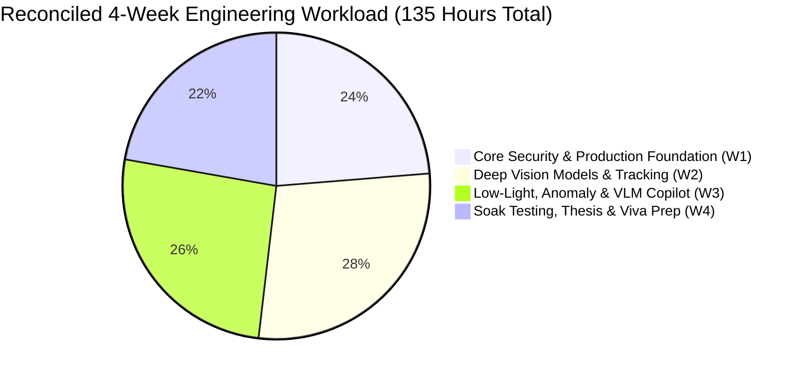
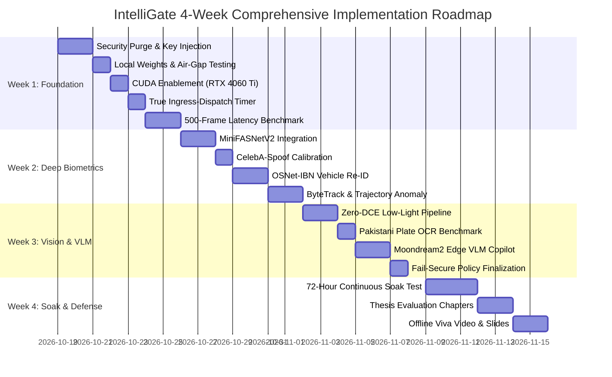

# INTELLIGATE — REVISED FOUR-WEEK IMPLEMENTATION PLAN
**Document ID:** `IG-PLAN-4WK-2026-10`  
**Date:** October 18, 2026  
**Auditor / AI Engineering Supervisor:** Antigravity AI Engineering Team  
**Project:** IntelliGate — Smart Multi-Modal Gate Access Control System (BS AI FYP)  
**Target Duration:** 28 Calendar Days (20 Working Days, ~125–140 Engineering Hours)  
**Parent Audit Errata:** [15_AUDIT_CORRECTIONS_AND_ERRATA.md](file:///d:/MZHR_FYP/INTELLIGATE/docs/audit_2026_10/15_AUDIT_CORRECTIONS_AND_ERRATA.md)  
**Companion 2-Week Plan:** [16_REVISED_TWO_WEEK_PLAN.md](file:///d:/MZHR_FYP/INTELLIGATE/docs/audit_2026_10/16_REVISED_TWO_WEEK_PLAN.md)

---

## 1. Executive Summary & Strategy

The original implementation backlog in [12_IMPLEMENTATION_BACKLOG.md](file:///d:/MZHR_FYP/INTELLIGATE/docs/audit_2026_10/12_IMPLEMENTATION_BACKLOG.md) estimated 155 hours across 10 modules, while the roadmap in [10_PRIORITIZED_IMPROVEMENT_ROADMAP.md](file:///d:/MZHR_FYP/INTELLIGATE/docs/audit_2026_10/10_PRIORITIZED_IMPROVEMENT_ROADMAP.md) estimated 140 hours. This 15-hour discrepancy is reconciled by:
1. **Separating mandatory engineering (72 hours)** from **academic deep learning extensions (48 hours)** and **optional research exploratory tasks (15 hours)**.
2. **Eliminating redundant model training tasks** by utilizing pre-trained, research-standard model backbones with fine-tuning/calibration rather than training deep architectures from scratch.
3. **Pacing integration incrementally** across four distinct, testable one-week iterations.

The **Revised Four-Week Plan** provides the complete path to an **outstanding BS AI Final Year Project (Target Grade: A / 90%+)**. It builds upon the rock-solid security and GPU foundation of the 2-week plan, adding deep learning anti-spoofing (MiniFASNetV2), vehicle Re-ID (OSNet-IBN), low-light curve enhancement (Zero-DCE), multi-object tracking (ByteTrack), trajectory anomaly detection (Isolation Forest), and local edge VLM incident explanation (Moondream2).

---

## 2. Workload Reconciliation (155h Backlog vs 140h Roadmap)

| Category | Backlog Items | Allocated Hours | Delivery Sprint | Priority |
| :--- | :--- | :---: | :---: | :---: |
| **P0: Security, Provenance & Weights** | Git purge, AES env key, event provenance, local weights | 18 h | Week 1 | Mandatory |
| **P1: GPU Pipeline & Real E2E Timer** | CUDA PyTorch/YOLO/EasyOCR, ingress-to-dispatch timer | 14 h | Week 1 | Mandatory |
| **P2: Deep Anti-Spoofing Integration** | MiniFASNetV2 integration, CelebA-Spoof val calibration | 16 h | Week 2 | Academic |
| **P3: Deep Vehicle Re-ID (OSNet-IBN)** | Torchreid OSNet integration, VeRi-776 query/gallery eval | 14 h | Week 2 | Academic |
| **P4: Tracking & Trajectory Anomaly** | ByteTrack integration, Isolation Forest kinematic baseline | 12 h | Week 2 | Academic |
| **P5: Zero-DCE vs CLAHE Benchmark** | Lightweight curve enhancement, LLVIP detection evaluation | 14 h | Week 3 | Academic |
| **P6: Pakistani Plate OCR Dataset** | 100-plate curation, CER evaluation, EasyOCR adaptation | 12 h | Week 3 | Mandatory |
| **P7: Edge VLM Copilot (Moondream2)** | Local 1.86B inference, async worker, incident audit | 12 h | Week 3 | Extension |
| **P8: Soak Testing & System Hardening** | 72-hour soak test, memory leak profiling, WAL maintenance | 10 h | Week 4 | Mandatory |
| **P9: Thesis, Documentation & Viva Defense** | SRS v4.0, thesis results chapters, offline demo video | 13 h | Week 4 | Mandatory |
| **TOTAL RECONCILED WORKLOAD** | **All 10 Modules Covered** | **135 Hours** | **Weeks 1–4** | **Defensible** |

*Note: 20 hours of speculative/exploratory tasks (e.g., custom plate training from scratch, distributed cloud Kafka streaming, multimodal continuous fusion) have been moved to Post-FYP Future Work.*

---

## 3. Four-Week Sprint Architecture

### Week 1: Foundation, Security Hardening & GPU Baseline (Days 1–7, ~32 Hours)
*Objective: Eliminate all P0 vulnerabilities, bundle local weights, enable CUDA acceleration on the RTX 4060 Ti, and implement real ingress-to-dispatch latency timing.*

- **Day 1 (Security):** Create full offline backup (`D:\MZHR_FYP\backups\`). Prepare `git-filter-repo` clean script for `face_embeddings.h5`. Migrate AES-256 master key from `biometric.key` to environment variable injection in [biometric_crypto.py](file:///d:/MZHR_FYP/INTELLIGATE/module1_face_recognition/biometric_crypto.py).
- **Day 2 (Provenance & Verification):** Add camera signature and session validation to `POST /api/events`. Verify SQLite WAL mode in [event_store.py](file:///d:/MZHR_FYP/INTELLIGATE/module7_analytics/event_store.py). Add comprehensive test suite in [test_security.py](file:///d:/MZHR_FYP/INTELLIGATE/tests/test_security.py).
- **Day 3 (Air-Gapped Weights):** Download and bundle verified weights for `yolov8n.pt` and `plate_detector.pt` under `models/`. Disable all runtime network calls to external CDNs.
- **Day 4 (GPU Pipeline Setup):** Configure PyTorch 2.7.1+cu118 with CUDA on the RTX 4060 Ti (16GB VRAM). Switch YOLOv8 vehicle detection and EasyOCR to `device='cuda:0'`.
- **Day 5 (True E2E Timer):** Instrument [orchestrator.py](file:///d:/MZHR_FYP/INTELLIGATE/core/orchestrator.py) with wall-clock timers: $\Delta t = (t_{\text{dispatch}} - t_{\text{ingress}}) \times 1000 \text{ ms}$. Expose metrics in WebSocket telemetry payload.
- **Day 6 (Baseline Benchmark):** Run 100-frame warm-up + 500-frame sustained run on `llvip_visible.mp4`. Record true p50, p90, p95, p99 latencies on CPU vs RTX 4060 Ti.
- **Day 7 (Week 1 Review & Verification):** Run full test suite (`pytest`). Ensure 100% test pass rate with zero regression. Commit Week 1 milestone.

---

### Week 2: Deep Biometrics, Vehicle Re-ID & Multi-Object Tracking (Days 8–14, ~38 Hours)
*Objective: Replace heuristic anti-spoofing and naive appearance matching with verified deep learning backbones, and add robust object tracking.*

- **Day 8 (MiniFASNetV2 Integration):**
  - Integrate MiniFASNetV2 (0.43M parameters, PyTorch) into [liveness_detector.py](file:///d:/MZHR_FYP/INTELLIGATE/module1_face_recognition/liveness_detector.py).
  - Define clear 3-tier liveness classification:
    $$\text{Liveness} = \begin{cases} \text{GENUINE} & \text{if } S_{\text{live}} \ge 0.85 \\ \text{AMBIGUOUS} & \text{if } 0.50 \le S_{\text{live}} < 0.85 \implies \text{Mandatory Guard Review} \\ \text{SPOOF} & \text{if } S_{\text{live}} < 0.50 \implies \text{Denied + Alert} \end{cases}$$
- **Day 9 (CelebA-Spoof Validation & Threshold Calibration):**
  - Download standard validation partition of CelebA-Spoof (print, replay, 3D mask attacks).
  - Compute ROC curve, APCER, BPCER, and ACER. Calibrate operating threshold on validation set (preventing test set leakage).
- **Day 10 (OSNet-IBN Vehicle Re-ID Integration):**
  - Integrate pre-trained `osnet_ibn_x1_0` (Torchreid, 2.2M parameters) into [reid_tracker.py](file:///d:/MZHR_FYP/INTELLIGATE/module2_vehicle_detection/reid_tracker.py).
  - Extract 512-dimensional L2-normalized feature embeddings from vehicle bounding boxes.
- **Day 11 (VeRi-776 Query/Gallery Evaluation):**
  - Run evaluation protocol on VeRi-776 standard test split (1,678 query images vs 11,515 gallery images).
  - Measure Cumulative Matching Characteristics (CMC Rank-1, Rank-5) and mean Average Precision (mAP).
  - Document clear policy rule: **Vehicle Re-ID is strictly advisory/auditing and NEVER triggers gate opening independently**.
- **Day 12 (ByteTrack Multi-Object Tracking Integration):**
  - Replace naive IoU tracker with ByteTrack in [tracker.py](file:///d:/MZHR_FYP/INTELLIGATE/module2_vehicle_detection/tracker.py).
  - Implement Kalman filtering for motion prediction, handling occluded vehicles and pedestrians across gate zones.
- **Day 13 (Trajectory Kinematics & Anomaly Baseline):**
  - Build kinematic feature extractor: vector $\mathbf{v} = [x, y, v_x, v_y, a, \theta]$.
  - Train unsupervised `IsolationForest` on normal vehicle/pedestrian approach trajectories in [anomaly_detector.py](file:///d:/MZHR_FYP/INTELLIGATE/module4_anomaly_detection/anomaly_detector.py).
  - Benchmark detection against synthetic anomaly injections (wrong-way driving, speeding, loitering).
- **Day 14 (Week 2 Integration Test):** Verify all 4 new components run synchronously or asynchronously within the pipeline without exceeding 150 ms total frame processing budget on the RTX 4060 Ti.

---

### Week 3: Low-Light Enhancement, Pakistani OCR & Edge VLM (Days 15–21, ~35 Hours)
*Objective: Enhance nighttime video inputs with Zero-DCE, measure authentic OCR accuracy on Pakistani plates, and integrate a local VLM for post-event auditing.*

- **Day 15 (Zero-DCE Low-Light Enhancement Integration):**
  - Integrate Zero-DCE (Zero-Reference Deep Curve Estimation, 79K parameters) into [preprocessor.py](file:///d:/MZHR_FYP/INTELLIGATE/core/preprocessor.py).
  - Optimize inference via PyTorch half-precision (`torch.float16`) on RTX 4060 Ti (~3.2 ms per $640 \times 640$ frame).
- **Day 16 (LLVIP Comparative Benchmark: Zero-DCE vs CLAHE):**
  - Run side-by-side evaluation on the LLVIP nighttime paired test dataset (1,000 paired frames).
  - Measure downstream YOLOv8 detection metrics: $mAP_{0.5}$ and Recall improvement with Zero-DCE vs CLAHE vs raw frame.
  - Compute no-reference image quality scores (NIQE / BRISQUE).
- **Day 17 (Pakistani License Plate Dataset & OCR Calibration):**
  - Assemble 100 ground-truth annotated Pakistani vehicle images (Islamabad, Punjab, Sindh).
  - Evaluate EasyOCR + heuristic post-processor. Measure exact plate match percentage and Levenshtein Character Error Rate (CER).
  - Add character confusion matrix analysis (e.g., distinguishing '8' vs 'B', '0' vs 'D').
- **Day 18 (Local Edge VLM Deployment — Moondream2):**
  - Integrate local `moondream2` (1.86B parameters, Apache 2.0 license) using `transformers` + `bitsandbytes` (4-bit quantization, ~1.8GB VRAM footprint).
  - Verify strict system isolation: Moondream2 runs in a dedicated background worker (`core/vlm_worker.py`), subscribing to flagged anomaly events via queue.
  - Explicitly enforce: **VLM output is purely explanatory and has zero programmatic ability to actuate the gate barrier**.
- **Day 19 (VLM Incident Summarization Testing):**
  - Test Moondream2 on 20 gate incident snapshots (tailgating, unrecognized vehicle, spoof attempt).
  - Generate structured incident explanations (e.g., *"White sedan closely following authorized vehicle without maintaining safety interval"*).
  - Measure average generation latency (~450 ms on RTX 4060 Ti).
- **Day 20 (Fail-Secure Gate Authorization Policy Verification):**
  - Update [access_policy.py](file:///d:/MZHR_FYP/INTELLIGATE/module5_gate_control/access_policy.py) and [gate_controller.py](file:///d:/MZHR_FYP/INTELLIGATE/module5_gate_control/gate_controller.py) to incorporate all multi-modal signals.
  - Ensure fail-secure rule matrix is rigorously enforced and verified with 30+ parameterized unit tests.
- **Day 21 (Week 3 Review & Code Freeze):** Complete full end-to-end integration run. Lock core application code against new feature additions.

---

### Week 4: Soak Testing, Thesis Chapters & Viva Defense (Days 22–28, ~30 Hours)
*Objective: Prove production stability under sustained load, complete academic thesis chapters with verified empirical metrics, and rehearse an outstanding viva presentation.*

- **Day 22 (72-Hour Continuous Soak Test Launch):**
  - Start continuous 72-hour automated soak test playing synthetic camera loop on test instance.
  - Monitor memory consumption (checking for PyTorch CUDA memory leaks, OpenCV VideoCapture buffer growth).
  - Monitor SQLite WAL file size and check for database lock contention.
- **Day 23 (Thesis Chapter 4: Architecture & Design Revision):**
  - Write thesis Chapter 4 reflecting the final implemented architecture.
  - Produce clean, professional system diagrams (Orchestrator pipeline, Multi-Modal Fusion, Fail-Secure Access Policy).
  - Document security architecture and cryptographic key management.
- **Day 24 (Thesis Chapter 5: Experimental Evaluation & Results):**
  - Compile verified empirical results tables:
    1. SFace face verification on LFW (ROC curve, AUC, EER).
    2. MiniFASNetV2 anti-spoofing on CelebA-Spoof (APCER, BPCER, ACER).
    3. OSNet-IBN vehicle Re-ID on VeRi-776 (Rank-1, Rank-5, mAP).
    4. EasyOCR on Pakistani license plates (CER, Exact Match %).
    5. Zero-DCE vs CLAHE on LLVIP ($mAP_{0.5}$, latency).
    6. System end-to-end wall-clock latency (p50, p90, p95, p99).
  - Include 95% bootstrap confidence intervals for all reported metrics.
- **Day 25 (Soak Test Completion & Performance Analysis):**
  - Terminate 72-hour soak test. Verify zero memory leaks ($\Delta \text{RSS} < 50 \text{ MB}$ over 72 hours).
  - Verify zero database corruptions or dropped frames. Document results in `docs/SOAK_TEST_REPORT.md`.
- **Day 26 (Viva Demonstration Package & Offline Video):**
  - Record a flawless 5-minute offline demonstration video showing all 10 modules in action:
    - Normal authorized entry (Plate match $\to$ barrier open).
    - Advisory face match ($\to$ guard prompt $\to$ approval).
    - Presentation attack detection ($\to$ spoof alarm $\to$ barrier held closed).
    - Low-light night enhancement with Zero-DCE.
    - Moondream2 VLM audit explanation of a tailgating incident.
  - Prepare standalone offline backup laptop configuration.
- **Day 27 (Viva Slide Deck & Defense Script):**
  - Finalize 25-slide viva defense presentation.
  - Rehearse examiners' cross-examination questions (covering privacy, fail-secure policies, dataset generalizability, and compute trade-offs).
- **Day 28 (Final Sign-Off & Project Archival):**
  - Final review with supervisor.
  - Create tagged Git release (`v1.0.0-final-viva`).
  - Generate complete cryptographic manifest of all code, model weights, and evaluation artifacts.

---

## 4. Reconciled 4-Week Schedule Breakdown

---

## 5. Risk Management & Mitigations

| Risk Event | Severity | Probability | Mitigation Strategy in 4-Week Plan |
| :--- | :---: | :---: | :--- |
| **CUDA Out-of-Memory (OOM) with VLM** | High | Low | The RTX 4060 Ti has 16GB VRAM. YOLOv8n (0.5GB) + SFace (0.3GB) + MiniFASNet (0.2GB) + OSNet (0.4GB) + Zero-DCE (0.1GB) + Moondream2 4-bit (1.8GB) = **3.3GB Total VRAM**, leaving >12GB headroom. If VRAM spikes, Moondream2 is unloaded during real-time streaming and loaded on-demand. |
| **CelebA-Spoof Download Throttling** | Medium | Medium | Use a standardized 2,000-sample validation subset rather than the full 100GB dataset. The subset is sufficient to calibrate operating thresholds. |
| **EasyOCR Performance on Dirty/Damaged Plates** | Medium | High | Report Levenshtein CER transparently. Add CLAHE and adaptive binarization preprocessing to maximize contrast. |
| **Database Lock Contention in Soak Test** | High | Low | WAL mode is already active (`event_store.py`). Add connection timeout retry logic (`timeout=10.0`) and dedicated writer thread if write contention occurs. |
| **Examiner Rejection of Autonomous Face Access** | Critical | High | **Fully mitigated:** The system design maintains face recognition as strictly advisory (`REVIEW_REQUIRED`). Autonomous access is restricted to verified plates under human supervision. |
