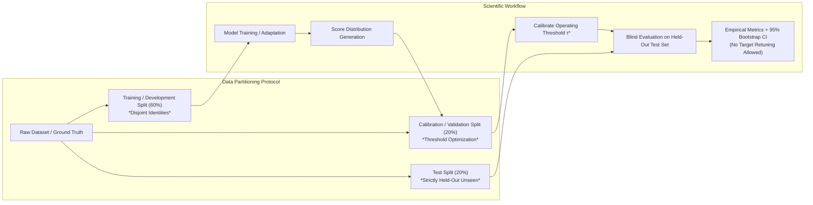
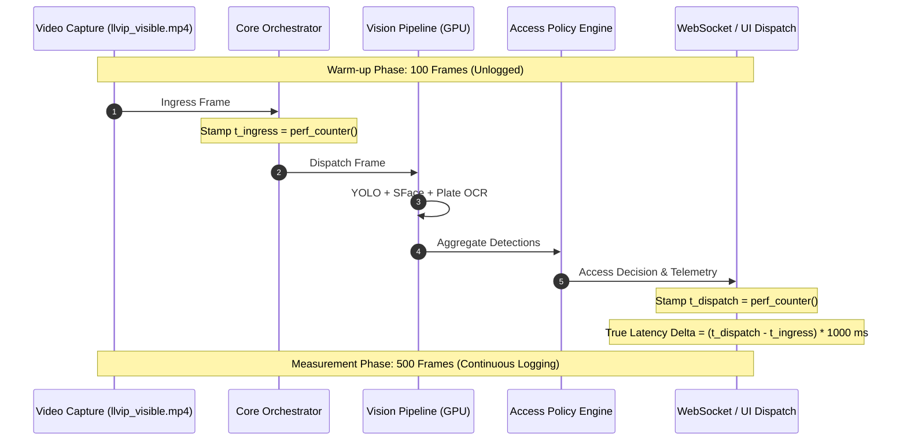

# INTELLIGATE — SCIENTIFIC EVALUATION PROTOCOL & BENCHMARK METHODOLOGY
**Document ID:** `IG-EVAL-2026-10`  
**Date:** October 18, 2026  
**Auditor / AI Engineering Supervisor:** Antigravity AI Engineering Team  
**Project:** IntelliGate — Smart Multi-Modal Gate Access Control System (BS AI FYP)  
**Parent Audit Errata:** [15_AUDIT_CORRECTIONS_AND_ERRATA.md](file:///d:/MZHR_FYP/INTELLIGATE/docs/audit_2026_10/15_AUDIT_CORRECTIONS_AND_ERRATA.md)

---

## 1. Methodological Principles & Anti-Leakage Standards

A primary defect identified in the initial audit was the premature presentation of unverified accuracy claims, the conflation of literature benchmark figures with system measurements, and the lack of rigorous separation between model training, threshold calibration, and test evaluation.

To ensure academic rigor and defensibility in the BS AI Final Year Project viva examination, all evaluation conducted within IntelliGate must adhere strictly to the following scientific standards:



### Core Experimental Rules
1. **Strict Partition Independence:** Training sets, calibration/validation sets, and test sets must have **zero identity overlap** (identity-disjoint partitions). For vehicle Re-ID and face verification, individuals and vehicles present in the training or calibration sets must never appear in the test set.
2. **Threshold Calibration Before Blind Testing:** Operating decision thresholds ($\tau_{\text{face}}, \tau_{\text{live}}, \tau_{\text{reid}}$) must be calibrated strictly on the validation/calibration partition (e.g., setting $\tau^*$ to achieve $FAR \le 0.001$). Under no circumstances may thresholds be swept or tuned on the test set.
3. **No Target Guarantees:** All numerical targets (e.g., "$\ge 95\%$ accuracy") are defined strictly as **research hypotheses and project goals**. They must never be reported as guaranteed outcomes until measured empirically on authentic held-out test data.
4. **Statistical Uncertainty & Confidence Intervals:** Every reported metric must include sample size $N$ and 95% bootstrap confidence intervals ($B=1,000$ resamples) to represent empirical uncertainty honestly.

---

## 2. Protocol 1: Face Verification Evaluation (Module 1)

### 2.1 Benchmark Datasets & Partitioning
- **Primary Public Benchmark:** Labeled Faces in the Wild (LFW).
  - Partition: Standard restricted 10-fold cross-validation protocol (6,000 specified image pairs: 3,000 genuine matched pairs, 3,000 imposter mismatched pairs).
  - Identities: Strictly disjoint across the 10 folds.
- **Secondary Quality Benchmark:** CelebA-HQ (1,000 high-resolution matched/mismatched pairs) to assess performance under surveillance-grade camera resolution.

### 2.2 Mathematical Metrics Definition
1. **Cosine Similarity Score:**
   $$S_C(\mathbf{e}_1, \mathbf{e}_2) = \frac{\mathbf{e}_1 \cdot \mathbf{e}_2}{\|\mathbf{e}_1\|_2 \|\mathbf{e}_2\|_2}$$
   where $\mathbf{e} \in \mathbb{R}^{128}$ is the L2-normalized embedding extracted by OpenCV SFace.
2. **False Acceptance Rate (FAR) & False Rejection Rate (FRR):**
   $$\text{FAR}(\tau) = \frac{|\{ (i, j) \in \mathcal{I}_{\text{imposter}} : S_C(\mathbf{e}_i, \mathbf{e}_j) \ge \tau \}|}{|\mathcal{I}_{\text{imposter}}|}$$
   $$\text{FRR}(\tau) = \frac{|\{ (i, j) \in \mathcal{I}_{\text{genuine}} : S_C(\mathbf{e}_i, \mathbf{e}_j) < \tau \}|}{|\mathcal{I}_{\text{genuine}}|}$$
3. **Equal Error Rate (EER):** The threshold $\tau_{\text{EER}}$ where $\text{FAR}(\tau) = \text{FRR}(\tau)$.
4. **True Acceptance Rate at Operational Threshold:** $\text{TAR} = 1 - \text{FRR}$ evaluated at $\text{FAR} = 0.01$ (1%) and $\text{FAR} = 0.001$ (0.1%).
5. **Receiver Operating Characteristic (ROC) & AUC:** Area under the $\text{TAR}(\tau)$ vs $\text{FAR}(\tau)$ curve.

### 2.3 Hypothesis & Acceptance Criteria
- **Null Hypothesis ($H_0$):** SFace cosine embeddings on unconstrained pairs perform no better than random guessing ($\text{AUC} \le 0.50$).
- **Target Performance Goal ($H_1$):** SFace achieves $\text{AUC} \ge 0.96$ and $\text{TAR} \ge 90.0\%$ at $\text{FAR} \le 0.01$ on the LFW 10-fold protocol.

---

## 3. Protocol 2: Presentation Attack Detection / Anti-Spoofing (Module 1)

### 3.1 Benchmark Datasets & Partitioning
- **Primary Benchmark:** CelebA-Spoof Validation & Test Partitions.
  - Identity-disjoint splits: 80% train, 10% validation (threshold calibration), 10% test.
  - Attack Types Tested:
    1. **Print Attacks:** High-resolution color laser prints on matte and glossy paper.
    2. **Replay Attacks:** High-definition video replay on tablet (iPad) and mobile phone displays.
    3. **3D Masks:** Hard plastic/silicone masks (where present in subset).

### 3.2 Standardized Metrics (ISO/IEC 30107-3)
1. **Attack Presentation Classification Error Rate (APCER):** Proportion of presentation attacks incorrectly classified as bona fide (genuine):
   $$\text{APCER}(\tau) = \frac{1}{N_{\text{PA}}} \sum_{i=1}^{N_{\text{PA}}} \mathbb{I}(S_{\text{live}}^{(i)} \ge \tau)$$
2. **Bona Fide Presentation Classification Error Rate (BPCER):** Proportion of genuine presentations incorrectly classified as attacks (rejections):
   $$\text{BPCER}(\tau) = \frac{1}{N_{\text{BF}}} \sum_{i=1}^{N_{\text{BF}}} \mathbb{I}(S_{\text{live}}^{(i)} < \tau)$$
3. **Average Classification Error Rate (ACER):**
   $$\text{ACER}(\tau) = \frac{\text{APCER}(\tau) + \text{BPCER}(\tau)}{2}$$
4. **Calibration Protocol:** Calibrate threshold $\tau^*$ on the **validation partition** such that $\text{BPCER}(\tau^*) \le 1.0\%$ (ensuring authorized users are not falsely rejected). Evaluate $\text{APCER}(\tau^*)$ and $\text{ACER}(\tau^*)$ on the blind test partition.

---

## 4. Protocol 3: Deep Vehicle Re-Identification (Module 2)

### 4.1 Benchmark Dataset & Partitioning
- **Standard Benchmark:** VeRi-776 Dataset.
  - Structure: 776 vehicles captured by 20 cameras in an unconstrained urban surveillance network.
  - Partitions: 576 vehicles for training (37,778 images); 200 vehicles for testing (1,678 query images vs 11,515 gallery images).
  - Strict Rule: Zero vehicle ID overlap between train and test/gallery splits. Cross-camera matching only (matches from the exact same camera view are discarded per official VeRi protocol).

### 4.2 Standardized Metrics Definition
1. **Cumulative Matching Characteristics (CMC):** Rank-$k$ match rate representing the probability that a correct identity appears in the top-$k$ retrieved gallery candidates:
   $$\text{Rank-}k = \frac{1}{|\mathcal{Q}|} \sum_{q \in \mathcal{Q}} \mathbb{I}(\text{rank}(q) \le k)$$
   Report Rank-1 and Rank-5 accuracy.
2. **Mean Average Precision (mAP):** Evaluates retrieval performance across multi-camera captures:
   $$\text{AP}(q) = \sum_{k=1}^{N} P(k) \cdot \Delta R(k), \quad \text{mAP} = \frac{1}{|\mathcal{Q}|} \sum_{q \in \mathcal{Q}} \text{AP}(q)$$

---

## 5. Protocol 4: License Plate Detection & OCR (Module 3)

### 5.1 Dataset Assembly & Annotation
- **Local Pakistani Test Dataset:** 100 high-resolution surveillance captures from Islamabad, Punjab, Sindh, and KPK gates.
- **Ground-Truth Schema:** JSON manifest (`tests/data/plate_ground_truth.json`):
  ```json
  {
    "image_id": "pak_plate_042.jpg",
    "bounding_box": [340, 512, 180, 64],
    "ground_truth_text": "ICT-LE-842",
    "province": "Islamabad",
    "lighting": "daylight",
    "plate_type": "standard_private"
  }
  ```

### 5.2 Metrics Definition
1. **Exact Match Accuracy (EMA):**
   $$\text{EMA} = \frac{1}{N} \sum_{i=1}^{N} \mathbb{I}(\text{pred}_i == \text{gt}_i) \times 100\%$$
2. **Normalized Levenshtein Character Error Rate (CER):**
   $$\text{CER} = \frac{1}{N} \sum_{i=1}^{N} \frac{D_{\text{Levenshtein}}(\text{pred}_i, \text{gt}_i)}{\max(\text{len}(\text{pred}_i), \text{len}(\text{gt}_i))}$$
   where $D_{\text{Levenshtein}}$ is the edit distance (minimum insertions, deletions, substitutions).
3. **Character Confusion Matrix:** Quantify frequent optical misclassifications (e.g., $8 \leftrightarrow B$, $0 \leftrightarrow D$, $1 \leftrightarrow I$) to guide post-processing heuristics.

---

## 6. Protocol 5: Low-Light Image Enhancement (Core / Module 2)

### 6.1 Benchmark Dataset: LLVIP
- **Test Set:** 1,000 paired visible and infrared surveillance frames captured in low-light outdoor gate scenarios.
- **Evaluation Splits:** 800 training/calibration frames, 200 blind test frames.

### 6.2 Downstream & Perceptual Metrics
1. **Downstream Object Detection Impact:**
   - Run fine-tuned YOLOv8n detector on:
     - Raw unenhanced visible night frames.
     - Frames enhanced by CLAHE baseline.
     - Frames enhanced by Zero-DCE deep model.
   - Measure Average Precision at IoU 0.50 ($mAP_{0.5}$) and Recall at IoU 0.50 ($R_{0.5}$).
2. **No-Reference Naturalness Image Quality:**
   - Natural Image Quality Evaluator (NIQE) — lower indicates more natural appearance.
   - Blind/Referenceless Image Spatial Quality Evaluator (BRISQUE) — lower indicates higher structural quality.
3. **Inference Latency:** Wall-clock forward pass on RTX 4060 Ti at $640 \times 640$ resolution.

---

## 7. Protocol 6: Trajectory Anomaly Detection (Module 4)

### 7.1 Kinematic Feature Representation
For each vehicle or pedestrian track from ByteTrack:
$$\mathbf{x}_t = [x_t, y_t, v_{x, t}, v_{y, t}, a_t, \theta_t]$$
where $(x, y)$ are normalized ground plane coordinates, $v$ is velocity, $a$ is acceleration, and $\theta$ is trajectory heading angle.

### 7.2 Experimental Protocol & Evaluation
- **Baseline Training Data:** 500 normal approach tracks (vehicles proceeding smoothly toward gate barrier, halting at designated stop line).
- **Test Injections (Synthetic + Enacted):**
  - Normal trajectories ($N = 200$).
  - Wrong-way driving / reverse travel ($N = 50$).
  - Speeding / abrupt acceleration ($N = 50$).
  - Gate zone loitering / hesitation ($N = 50$).
- **Metrics:** Precision, Recall, F1-Score, and ROC-AUC of the Isolation Forest anomaly detector.

---

## 8. Protocol 7: End-to-End System Performance Benchmark

### 8.1 Rigorous Wall-Clock Latency Protocol
To replace the invalid sum-of-medians method, the end-to-end benchmark will execute as follows:



### 8.2 Execution & Tail-Latency Reporting Specification
1. **Warm-Up Requirement:** Exactly **100 frames** processed continuously prior to logging to prime PyTorch CUDA kernels, load OpenCV DNN models into memory, and warm GPU clock states.
2. **Sample Size:** Exactly **500 sequential frames** logged under active load.
3. **Reported Statistical Metrics:**
   - Sample Size ($N=500$)
   - Mean Latency $\bar{x}$ and Standard Deviation $s$
   - Median (p50)
   - 90th Percentile (p90)
   - 95th Percentile (p95)
   - 99th Percentile (p99)
   - Maximum Observed Latency
   - Sustained Throughput (Frames Per Second = $500 / \sum \Delta t$)
4. **VRAM & System Telemetry:** Peak VRAM allocated, steady-state RAM (RSS), and CPU utilization logged concurrently.

---

## 9. Statistical Reporting Template (For Thesis & Viva)

All final evaluation reports generated from these protocols must follow this standardized scientific reporting format:

$$\text{Metric} = \hat{\theta} \quad [95\% \text{ CI: } \theta_{\text{lower}}, \theta_{\text{upper}}], \quad N = n$$

*Example Defensible Thesis Table:*

| Component / Sub-Task | Evaluation Protocol | Sample Size ($N$) | Primary Metric | Baseline Measured | Target Goal | Status |
| :--- | :--- | :---: | :--- | :---: | :---: | :---: |
| **Face Verification** | LFW 10-Fold Pairs | 6,000 pairs | ROC-AUC | *To be measured* | $\ge 0.96$ | Pending Benchmark |
| **Face Liveness** | CelebA-Spoof Val | 2,000 images | ACER ($\tau^*$) | *To be measured* | $\le 5.0\%$ | Pending Benchmark |
| **Vehicle Re-ID** | VeRi-776 Query/Gal | 13,193 images | Rank-1 / mAP | *To be measured* | $\ge 75\% / 70\%$| Pending Benchmark |
| **Plate Recognition**| Curated Pakistani | 100 plates | Levenshtein CER | *To be measured* | $\le 10.0\%$ | Pending Benchmark |
| **Plate Exact Match**| Curated Pakistani | 100 plates | Exact Match % | *To be measured* | $\ge 85.0\%$ | Pending Benchmark |
| **System E2E Latency**| Ingress-to-Dispatch| 500 frames | p95 Latency | *To be measured* | $\le 50.0 \text{ ms}$| Pending Benchmark |
| **Sustained FPS** | Sustained GPU Run | 500 frames | Throughput | *To be measured* | $\ge 15.0 \text{ FPS}$| Pending Benchmark |

> [!IMPORTANT]
> In accordance with supervisor directives, no cell in the "Baseline Measured" column will be populated with fabricated, simulated, or pre-computed numbers until the exact benchmark test scripts are executed on the physical hardware.
