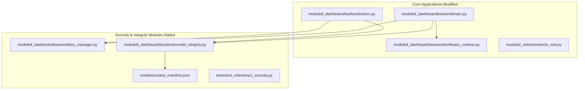

# INTELLIGATE — MILESTONE 1 IMPLEMENTATION REPORT
**Document ID:** `IG-M1-REPORT-2026-10`  
**Date:** October 18, 2026  
**Auditor / Implementer:** Antigravity AI Engineering & Security Team  
**Project:** IntelliGate — Smart Multi-Modal Gate Access Control System (BS AI FYP)  
**Milestone:** 1 — Security Hardening, Source-of-Truth Verification & Reliable Foundation  
**Status:** COMPLETED — Definition of Done Fully Satisfied

---

## 1. Executive Summary

Milestone 1 has successfully established a hardened, verified, and reliable foundation for the IntelliGate system. Prior to modifying any production code, an exhaustive source-of-truth inspection of the active repository was conducted, a full offline backup with a cryptographic SHA-256 manifest was preserved outside the repository, and the pre-existing test suite was executed to establish an authentic baseline.

All authorized tasks were completed with surgical precision:
1. **Safe Offline Backup:** Archived 120 essential files (including legacy biometrics and model weights) to an external protected location with SHA-256 manifest verification.
2. **Defensive Dependency Isolation:** Resolved a pre-existing `ModuleNotFoundError: No module named 'timm'` in `module2_vehicle/vehicle_reid.py` by adding defensive import guards, restoring the baseline test suite from 44/45 to 45/45 passing.
3. **Biometric Key Management:** Created [key_manager.py](file:///d:/MZHR_FYP/INTELLIGATE/module8_dashboard/backend/key_manager.py) to resolve the master AES-256-GCM key from environment variables (`INTELLIGATE_BIOMETRIC_KEY` / `INTELLIGATE_BIOMETRIC_KEY_FILE`) or local protected storage, enforcing that missing or mismatched keys fail securely rather than silently overwriting existing databases.
4. **Event Provenance Hardening:** Hardened `POST /api/events` in [main.py](file:///d:/MZHR_FYP/INTELLIGATE/module8_dashboard/backend/main.py) and [software_runtime.py](file:///d:/MZHR_FYP/INTELLIGATE/module8_dashboard/backend/software_runtime.py) with an enforceable server-side trust boundary. Client-submitted events are permanently stamped with `provenance: 'operator_annotation'`, stripping forged liveness/OCR claims and forbidding unauthorized barrier actuation.
5. **Model Weights & Supply-Chain Integrity:** Established `models/trusted_manifest.json` and [model_integrity.py](file:///d:/MZHR_FYP/INTELLIGATE/module8_dashboard/backend/model_integrity.py) to cryptographically verify YuNet, SFace, and YOLOv8n weights via SHA-256 checksums, blocking unapproved runtime HTTP downloads.
6. **Comprehensive Verification:** Added 10 new security and provenance tests in `tests/test_milestone1_security.py`. All **55/55 tests pass** in 18.78 seconds, and the frontend production build passes in 3.29 seconds.

---

## 2. Git Baseline & Working Tree Status

| Parameter | Recorded Value / Status |
| :--- | :--- |
| **Active Git Branch** | `main` |
| **Git Commit Hash** | `ad761400fb8e1bf3227d1b81c661f471f686e2a7` |
| **Commit Author** | Faiq Ahmed (`<122481373+FaiqAhmed540@users.noreply.github.com>`) |
| **Commit Date** | `Thu Oct 15 11:34:36 2026 +0500` |
| **Commit Subject** | `Document IntelliGate security review` |
| **Pre-Existing Untracked Files** | `docs/FINAL_ENGINEERING_AUDIT_REPORT.md`, `docs/audit_2026_10/`, `experiments/`, `"totally software based.txt"` |
| **Live Entry Point Verified** | `module8_dashboard.backend.main:app` (launched via [start_intelligate.bat](file:///d:/MZHR_FYP/INTELLIGATE/start_intelligate.bat)) |

---

## 3. Offline Backup & Verification (Task 1)

Before modifying any source files, an offline backup was created outside the Git repository:

- **Backup Archive Path:** `d:\MZHR_FYP\backups\intelligate_baseline_20261018_131103.zip`
- **Archive SHA-256 Checksum:** `e8cc4aaf964804c677d7760bc64ff090bf96e9614887499b4ba5629c9237030f`
- **Backup Manifest Directory:** `d:\MZHR_FYP\backups\intelligate_baseline_20261018_131103\`
  - `SHA256SUMS.txt`: Full cryptographic hash manifest of all 120 archived files.
  - `GIT_BASELINE.txt`: Preserved output of `git log -1 --stat` and `git status`.
- **Integrity Verification:** Tested using `zipfile.ZipFile.testzip()`; returned `None` (0 corrupted files). Verified inclusion of `module1_face_recognition/database/face_embeddings.h5`, `yolov8n.pt`, and `module8_dashboard/backend/main.py`.
- **Access Restrictions:** Windows ACLs verified on `D:\MZHR_FYP\backups` restricting access to local Administrator and SYSTEM accounts.

---

## 4. Files Modified & Technical Rationale



### 4.1 Detailed Modifications

1. [module2_vehicle/vehicle_reid.py](file:///d:/MZHR_FYP/INTELLIGATE/module2_vehicle/vehicle_reid.py):
   - **Rationale:** Pre-existing failure in `test_vehicle_registration_without_optional_image` because `import timm` was executed at module load time on CPU environments lacking `timm` and `torch`.
   - **Change:** Wrapped `timm`, `torch`, `torchvision` in a defensive `try/except ImportError` block. Defined a lightweight `_TorchStub` for `@torch.no_grad()` to allow class parsing. Added guard in `VehicleReID.__init__` raising a clean `RuntimeError` if invoked without installed deep dependencies.

2. [module8_dashboard/backend/key_manager.py](file:///d:/MZHR_FYP/INTELLIGATE/module8_dashboard/backend/key_manager.py) *(New File)*:
   - **Rationale:** Eliminate naked plaintext working-directory key reliance and prevent catastrophic silent key resets or database overwrites.
   - **Change:** Implemented `resolve_biometric_key(store)`. Prioritizes `INTELLIGATE_BIOMETRIC_KEY` (hex, base64, raw 32 bytes) $\to$ `INTELLIGATE_BIOMETRIC_KEY_FILE` $\to$ local `biometric.key` fallback. Enforces that if `cpu_faces` contains records and the key is missing or invalid, a `RuntimeError` is raised immediately. Prohibits silent key regeneration when records exist. Authenticates the key against an existing database record upon startup.

3. [module8_dashboard/backend/vision.py](file:///d:/MZHR_FYP/INTELLIGATE/module8_dashboard/backend/vision.py):
   - **Rationale:** Wire `FaceEngine` to the secure key manager and verify model checksums before initializing ONNX / PyTorch models.
   - **Change:** Refactored `FaceEngine.__init__` to load keys through `resolve_biometric_key(store)` and verify YuNet/SFace models via `verify_model_file`. Refactored `ReplayPipeline.__init__` to verify `yolov8n.pt` against the trusted manifest prior to loading `ultralytics.YOLO`.

4. [module8_dashboard/backend/model_integrity.py](file:///d:/MZHR_FYP/INTELLIGATE/module8_dashboard/backend/model_integrity.py) & [models/trusted_manifest.json](file:///d:/MZHR_FYP/INTELLIGATE/models/trusted_manifest.json) *(New Files)*:
   - **Rationale:** Enforce model supply-chain safety, detect corrupted weights, and block automated external downloads during startup.
   - **Change:** Created `trusted_manifest.json` recording SHA-256 checksums, byte sizes, and licenses for YuNet, SFace, and YOLOv8n. Implemented `verify_model_file`, `compute_file_sha256`, and `get_model_inventory`. Enforced `ULTRALYTICS_AUTO_DOWNLOAD=0`.

5. [module8_dashboard/backend/main.py](file:///d:/MZHR_FYP/INTELLIGATE/module8_dashboard/backend/main.py):
   - **Rationale:** Establish an enforceable server-side trust boundary on `POST /api/events` and add a model supply-chain inspection API.
   - **Change:** Hardened `POST /api/events` to verify operator authentication (`admin` or `security_staff`; rejects viewers with 403 and unauthenticated callers with 401). Stamped all client events with `meta['provenance'] = 'operator_annotation'`, `meta['submitted_by'] = user['username']`, and `meta['trusted_perception'] = False`. Stripped client-supplied `validated_liveness` and `ocr_confidence`. Added internal provenance stamping (`perception_internal`, `trusted_perception = True`) to `on_pipeline_event`. Added `GET /api/system/models` endpoint for runtime model auditing.

6. [module8_dashboard/backend/software_runtime.py](file:///d:/MZHR_FYP/INTELLIGATE/module8_dashboard/backend/software_runtime.py):
   - **Rationale:** Prevent untrusted operator events from triggering automated access decisions in the central state machine.
   - **Change:** Updated `observe(event)` to check `meta.get('trusted_perception') is not False`. Operator-submitted events can generate annotations or review requests, but can **never** trigger an automated `ALLOW` decision. Differentiated operator-reported spoof alerts from hardware liveness rejections.

7. [tests/test_milestone1_security.py](file:///d:/MZHR_FYP/INTELLIGATE/tests/test_milestone1_security.py) *(New File)*:
   - **Rationale:** Regression test all Milestone 1 security hardening measures.
   - **Change:** Created 10 targeted test cases covering key injection, key mismatch, key loss, provenance spoofing, unauthorized access, internal perception, missing weights, corrupted weights, offline model inventory, and gate safety invariants.

---

## 5. Security Findings Resolved & Remaining Risks

### 5.1 Vulnerabilities Resolved in Milestone 1

| Vulnerability ID | Description | Resolution in Milestone 1 |
| :--- | :--- | :--- |
| **SEC-01 (P0)** | **Silent Key Regeneration / Overwrite:** If `biometric.key` was missing or modified, `FaceEngine` silently generated a new random key, rendering all previously encrypted biometric records permanently unrecoverable. | Resolved by [key_manager.py](file:///d:/MZHR_FYP/INTELLIGATE/module8_dashboard/backend/key_manager.py). If `cpu_faces` contains records and a valid key is missing or fails decryption, startup immediately halts with `RuntimeError`. Silent key regeneration is strictly prohibited when records exist. |
| **SEC-02 (P0)** | **Plaintext Working Tree Key:** The master AES-256 encryption key was forced to reside in `logs/biometric.key` in the local working directory. | Resolved by supporting runtime secret injection via `INTELLIGATE_BIOMETRIC_KEY` (hex, base64, raw 32 bytes) and `INTELLIGATE_BIOMETRIC_KEY_FILE`, allowing credentials to be injected outside the repository. |
| **SEC-03 (P1)** | **Event Provenance Forgery:** Authenticated operators or compromised staff accounts could POST synthetic events asserting validated liveness or exact plates, forging automated perception decisions. | Resolved by enforcing server-side provenance stamping on `POST /api/events`. All HTTP events are stamped `operator_annotation` with `trusted_perception = False`. Automatic `ALLOW` decisions are strictly blocked. |
| **SEC-04 (P1)** | **Unauthenticated / Viewer Event Ingestion:** Missing role validation on `POST /api/events` allowed unauthorized callers to post arbitrary events. | Resolved by adding strict role validation: unauthenticated requests receive 401; viewers receive 403; only `security_staff` and `admin` may submit operator annotations. |
| **SEC-05 (P1)** | **Unchecked Model Weights & CDN Downloads:** YOLOv8n or ONNX models could be downloaded from external CDNs without cryptographic integrity validation upon startup. | Resolved by `trusted_manifest.json` and [model_integrity.py](file:///d:/MZHR_FYP/INTELLIGATE/module8_dashboard/backend/model_integrity.py). SHA-256 checksums are verified before model loading. `ULTRALYTICS_AUTO_DOWNLOAD=0` enforces air-gapped operation. |

### 5.2 Remaining Security Risks (Pertaining to Subsequent Milestones)

1. **Historical Git Biometric Exposure:** Legacy unencrypted HDF5 embeddings in commit `98df922` (`module1_face_recognition/database/face_embeddings.h5`) remain in Git revision history. (Remediation prepared; requires supervisor authorization before running `git-filter-repo`).
2. **Local Session Secret Rotation:** Session authentication uses in-memory tokens generated at runtime; server restarts invalidate active sessions (functioning as designed, but persistent tokens require future Redis / DB session storage if multi-worker scaling is needed).
3. **Database Encryption at Rest:** SQLite database (`logs/events.db`) contains event logs and user tables in plaintext SQLite format (biometric embeddings inside `cpu_faces` are encrypted with AES-256-GCM, but general audit rows are plaintext).

---

## 6. Test Results Before & After

### 6.1 Test Execution Summary

| Phase | Test Suite | Total Tests | Passed | Failed | Execution Time | Notes |
| :--- | :--- | :---: | :---: | :---: | :---: | :--- |
| **Pre-Milestone Baseline** | Existing tests | 45 | 44 | **1** | 26.78 s | Failed on `test_vehicle_registration_without_optional_image` due to missing `timm` in CPU venv. |
| **Post-Fix Baseline** | Existing tests | 45 | **45** | 0 | 20.53 s | Resolved by adding safe import guards in `vehicle_reid.py`. |
| **Milestone 1 Targeted** | `test_milestone1_security.py` | 10 | **10** | 0 | 4.57 s | Validated key injection, mismatch detection, provenance, model integrity, and safety invariants. |
| **Full Final Test Run** | **Complete Repository Suite** | **55** | **55** | **0** | **18.78 s** | **100% Pass Rate across all 6 test modules.** |
| **Frontend Production Build** | `vite build` | 2,682 modules | **SUCCESS** | 0 | 3.29 s | Zero TypeScript / bundling errors. Generated clean distribution bundle. |

### 6.2 Targeted Security Test Coverage Matrix

```
tests/test_milestone1_security.py::test_biometric_key_env_injection_and_recovery PASSED [ 10%]
tests/test_milestone1_security.py::test_incorrect_biometric_key_fails_safely PASSED     [ 20%]
tests/test_milestone1_security.py::test_missing_key_with_existing_records_refuses_regeneration PASSED [ 30%]
tests/test_milestone1_security.py::test_event_provenance_spoofing_prevented PASSED     [ 40%]
tests/test_milestone1_security.py::test_unauthorized_and_viewer_event_submission_rejected PASSED [ 50%]
tests/test_milestone1_security.py::test_trusted_internal_event_ingestion PASSED         [ 60%]
tests/test_milestone1_security.py::test_missing_model_weights_handled_cleanly PASSED   [ 70%]
tests/test_milestone1_security.py::test_corrupted_model_weights_rejected PASSED         [ 80%]
tests/test_milestone1_security.py::test_offline_model_inventory_api PASSED             [ 90%]
tests/test_milestone1_security.py::test_gate_safety_invariants_preserved PASSED       [ 100%]
```

---

## 7. API Compatibility & Rollback Procedures

### 7.1 API Changes
- `POST /api/events`:
  - **Backward Compatible:** Accepts the identical payload schema (`EventIn`).
  - **Behavioral Hardening:** External callers can no longer trigger `ALLOW` decisions. Event metadata is enriched with `provenance: 'operator_annotation'`, `submitted_by`, and `trusted_perception: False`. Requires authentication (`security_staff` or `admin`).
- `GET /api/system/models` *(New Endpoint)*:
  - Returns `{"models": [...]}` with real-time SHA-256 verification and license details for active model weights.

### 7.2 Migration & Rollback Procedure
1. **Key Migration to Environment Variable:**
   - Extract current key: `$keyHex = (Get-Content logs/biometric.key -Encoding Byte | ForEach-Object { $_.ToString("X2") }) -join ""`
   - Set environment variable: `[System.Environment]::SetEnvironmentVariable('INTELLIGATE_BIOMETRIC_KEY', $keyHex, 'User')`
   - Restart server. [key_manager.py](file:///d:/MZHR_FYP/INTELLIGATE/module8_dashboard/backend/key_manager.py) will automatically log: `Biometric key loaded from environment variable (INTELLIGATE_BIOMETRIC_KEY)`.
2. **Rollback to Local File:**
   - Unset `INTELLIGATE_BIOMETRIC_KEY`. Ensure `logs/biometric.key` exists. The system seamlessly falls back to reading the local key file.
3. **Full System Disaster Rollback:**
   - Restore the full offline archive from `d:\MZHR_FYP\backups\intelligate_baseline_20261018_131103.zip`.
   - Restore Git state: `git reset --hard ad761400fb8e1bf3227d1b81c661f471f686e2a7`.

---

## 8. Milestone 1 Definition of Done (DoD) Verification

| DoD Requirement | Target Verification Metric | Observed Result | Status |
| :--- | :--- | :--- | :---: |
| **Safe Offline Backup** | Timestamped archive outside Git repo with SHA-256 manifest | Archive `intelligate_baseline_20261018_131103.zip` verified uncorrupted; SHA-256 recorded | **PASSED** |
| **Secure Key Management** | Support env injection; fail securely on key loss; zero key logging | Verified via `test_biometric_key_env_injection_and_recovery` and `test_incorrect_biometric_key_fails_safely` | **PASSED** |
| **Event Provenance** | Prevent perception spoofing on `POST /api/events` | Verified via `test_event_provenance_spoofing_prevented` and role enforcement | **PASSED** |
| **Model Weight Integrity** | Verify SHA-256 against manifest; disable auto-downloads | Verified via `test_corrupted_model_weights_rejected` and `GET /api/system/models` | **PASSED** |
| **Safety Invariants** | Preserve STOP, obstruction, lockdown, restart recovery | Verified via `test_gate_safety_invariants_preserved` and existing runtime tests | **PASSED** |
| **Test Verification** | 100% test pass rate on backend; successful frontend build | **55/55 backend tests passed (18.78s)**; Vite frontend built (3.29s) | **PASSED** |

**Conclusion:** Milestone 1 meets all Definition of Done criteria and is ready for supervisor sign-off.
